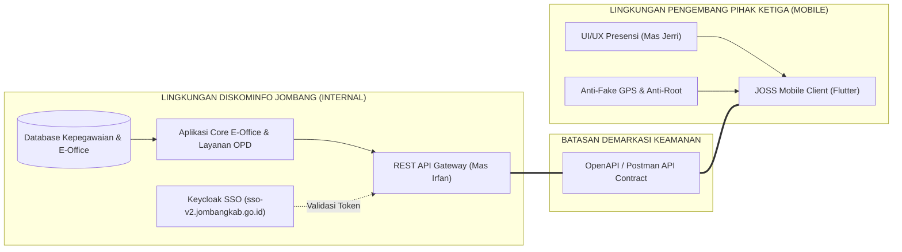
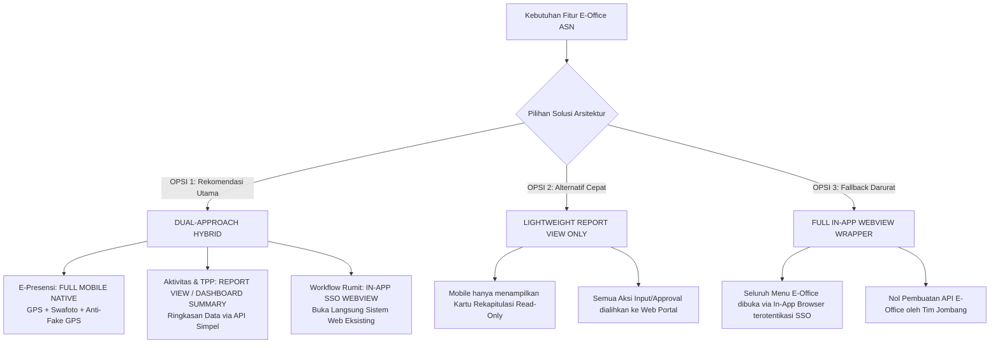
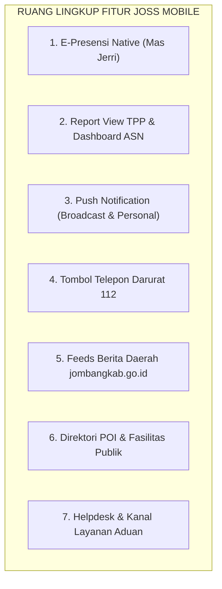
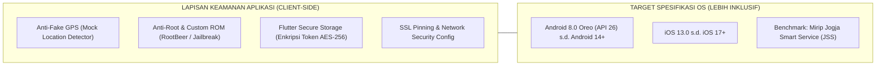
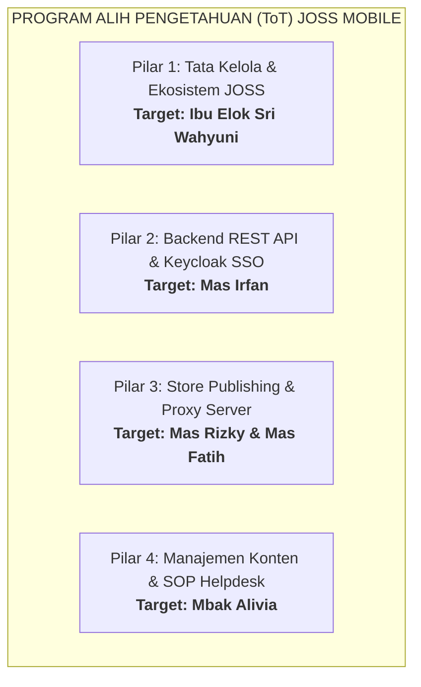
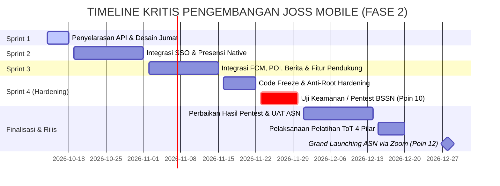

# ANALISIS IDENTIFIKASI KEBUTUHAN & REKOMENDASI STRATEGIS TEKNIS
## PENGEMBANGAN APLIKASI JOSS MOBILE (FASE 2)
### INTEGRASI HASIL KUESIONER KOMINFO JOMBANG DENGAN NOTULENSI TIM INTERNAL

> **Status Dokumen:** Rekomendasi Resmi Tim Pengembang (Pihak Ketiga / Konsultan Mobile)  
> **Tanggal Rilis:** 14 Oktober 2026  
> **Dasar Rujukan:**  
> 1. Dokumen Pemetaan Kuesioner Diskominfo Jombang ([HASIL_MAPPING_KUESIONER_KOMINFO_JOMBANG.md](file:///d:/sso_jos/HASIL_MAPPING_KUESIONER_KOMINFO_JOMBANG.md))  
> 2. Notulensi Rapat Internal Tim Pengembang (21 Poin Kesepakatan Teknis)  
> 3. Kerangka Kerja Arsitektur & Business Requirement Document (BRD) JOSS Mobile  

---

## DAFTAR ISI
1. [Prinsip Batasan Peran Pihak Ketiga & Demarkasi Tanggung Jawab](#1-prinsip-batasan-peran-pihak-ketiga--demarkasi-tanggung-jawab)
2. [Sintesis Pemetaan 21 Poin Notulensi Internal vs Kuesioner Jombang](#2-sintesis-pemetaan-21-poin-notulensi-internal-vs-kuesioner-jombang)
3. [Analisis Kritis & Rekomendasi Solusi Modul E-Office](#3-analisis-kritis--rekomendasi-solusi-modul-e-office)
4. [Rincian Rekomendasi Teknis per Modul Prioritas](#4-rincian-rekomendasi-teknis-per-modul-prioritas)
5. [Spesifikasi Keamanan & Kompatibilitas Perangkat](#5-spesifikasi-keamanan--kompatibilitas-perangkat)
6. [Roadmap, Tata Kelola Tim, & Pembagian Peran ToT](#6-roadmap-tata-kelola-tim--pembagian-peran-tot)
7. [Target Milestone Terdekat (Presentasi Jumat) & Kolaborasi Trello](#7-target-milestone-terdekat-presentasi-jumat--kolaborasi-trello)
8. [Matriks Keputusan (Sign-off Readiness) untuk Pertemuan Bersama](#8-matriks-keputusan-sign-off-readiness-untuk-pertemuan-bersama)

---

<a name="1-prinsip-batasan-peran-pihak-ketiga--demarkasi-tanggung-jawab"></a>
## 1. PRINSIP BATASAN PERAN PIHAK KETIGA & DEMARKASI TANGGUNG JAWAB

Untuk menjaga akuntabilitas, integritas data, dan keamanan infrastruktur Pemerintah Kabupaten Jombang, posisi Tim Pengembang (Pihak Ketiga) ditegaskan sebagai berikut:



### Pokok-Pokok Demarkasi:
1. **Posisi Vendor murni sebagai *API Consumer* (Frontend Client):**  
   Tim Pengembang bertugas merancang aplikasi mobile (Flutter), pengalaman pengguna (UI/UX), penanganan cache lokal, keamanan client-side, dan pemanggilan layanan melalui protokol RESTful API standar.
2. **Tidak Masuk ke Server Internal / Database Core Jombang:**  
   Pihak ketiga **TIDAK** diperbolehkan dan **TIDAK MEMILIKI HAK AKSES** untuk masuk ke server produksi internal, mengubah skema basis data, atau menulis kode langsung pada backend core milik Pemkab Jombang.
3. **Penyediaan API adalah Tanggung Jawab Penuh Diskominfo Jombang:**  
   Semua data yang ditampilkan atau diproses di aplikasi mobile wajib disediakan melalui *REST API endpoint* yang aman (Bearer Token SSO Keycloak) yang disiapkan oleh programmer internal Diskominfo Jombang (Mas Irfan).
4. **Keterikatan Waktu & Ketergantungan API (SLA):**  
   Fitur mobile native hanya dapat dikembangkan dan diuji apabila spesifikasi dan endpoint API dari Tim Jombang telah beroperasi dan dapat dipanggil dengan respons JSON yang valid.

---

<a name="2-sintesis-pemetaan-21-poin-notulensi-internal-vs-kuesioner-jombang"></a>
## 2. SINTESIS PEMETAAN 21 POIN NOTULENSI INTERNAL VS KUESIONER JOMBANG

Berikut adalah komparasi mendalam antara 21 poin hasil rapat notulensi internal terhadap data kuesioner resmi Diskominfo Jombang:

| No | Poin Notulensi Internal | Fakta / Isian Kuesioner Jombang | Analisis & Implikasi Lapangan | Sikap & Rekomendasi Pihak Ketiga |
|:---:|:---|:---|:---|:---|
| **1** | **Berita sudah ada API-nya (perlu dipastikan lagi)** | Sumber `jombangkab.go.id/berita`, API dinyatakan ada/bisa disediakan oleh Irfan. | Secara dokumen ada, namun saat tim pengembang melakukan uji koneksi, endpoint belum siap konsumsi. | Lakukan audit endpoint bersama Mas Irfan untuk memverifikasi URL dan format respon JSON. |
| **2** | **E-Office $\rightarrow$ presensi saja yang diakomodir** | Kuesioner meminta 5 fitur: presensi, aktivitas, input aktivitas, approval, rincian TPP. | Modul E-Office ASN terlampau luas dan kompleks untuk dijadikan full-native dalam kurun waktu 1,5 bulan. | **Fokuskan Native HANYA pada Presensi**. Modul E-Office lainnya dialihkan ke Report View atau In-App WebView. |
| **3** | **Bila E-Office belum ada API-nya $\rightarrow$ ditanyakan** | Kuesioner mencantumkan status endpoint E-Office: *Belum tersedia*. | Tim backend Jombang belum memiliki dokumentasi Swagger/Postman untuk E-Office. | Minta kejelasan roadmap ketersediaan API dari Diskominfo. Jika API belum ada, native e-office mustahil selesai November. |
| **4** | **Fokuskan E-Office ke presensi dulu** | ASN menjadi target pengguna prioritas tahap awal launching. | Presensi adalah kebutuhan harian paling vital ASN dan dampaknya instan (*high engagement*). | Ajukan proposal lingkup presensi sebagai ruang lingkup utama native E-Office ke Diskominfo. |
| **5** | **Lebih baik presensi / jika ada service API tinggal panggil** | Belum ada dokumentasi spesifikasi payload API presensi. | Pihak ketiga siap mengintegrasikan API presensi secara cepat asalkan contract API sudah disepakati. | MBO siapkan template kontrak API (request/response JSON) presensi untuk langsung diisi backend Jombang. |
| **6** | **Notifikasi ada 2 (Grup & Personal)** | Kuesioner menyebutkan push notifikasi via Firebase Cloud Messaging (FCM). | Kebutuhan riil: Notifikasi siaran publik (Semua warga) vs Notifikasi kedinasan khusus ASN tertentu (Personal/Targeted). | Bangun arsitektur FCM dengan 2 mode: *Topic Subscription* (Grup) dan *Direct Device Token* berbasis User ID Keycloak (Personal). |
| **7** | **Request button telepon bisa aman** | Kuesioner meminta tombol telepon Call Center 112 dan kontak penting OPD. | Fitur berisiko rendah dan mudah diimplementasikan melalui sistem native URL Launcher / Intent Call. | **Disetujui penuh (Aman)**. Masukkan ke rilis rilis awal. Cukup butuh daftar nomor resmi dari Diskominfo. |
| **8** | **Direktori Point of Interest (POI) perlu dikonfirmasi** | Kuesioner meminta format List dan Map interaktif. | Perlu batasan: Apakah hanya direktori statis titik lokasi atau melibatkan sistem routing/navigasi GPS dinamis? | Konfirmasi ke Diskominfo: Rekomendasikan format *Directory List* dilengkapi tombol *"Buka di Google Maps"* agar efisien. |
| **9** | **Batas minimal Android dicek Mas Imam** | Kuesioner menuliskan Android 11 / Kondisional. | Android 11 memotong populasi pengguna HP lama (banyak warga dan ASN masih menggunakan Android 8/9/10). | Mas Imam memastikan compatibility build Flutter dengan baseline target SDK. |
| **10** | **Akhir November target Penetration Testing** | Kuesioner menegaskan pentest ITSA BSSN wajib sebelum rilis (akhir Nov). | Waktu efektif development hanya tersisa $\pm$ 5-6 minggu sebelum aplikasi dibekukan (*code freeze*) untuk audit keamanan. | Semua fitur inti native harus selesai sebelum tanggal 20 November 2026 agar lolos scanning BSSN. |
| **11** | **Hasil analisis kebutuhan berupa rekomendasi sesuai waktu** | Peluncuran dipatok akhir Desember 2026. | Waktu sangat terbatas; ruang lingkup harus diseleksi secara ketat (*timeboxing strategy*). | Terbitkan dokumen rekomendasi ini sebagai acuan pemangkasan fitur yang tidak realistis. |
| **12** | **Grand Launching akhir Desember (ke ASN)** | Sosialisasi akbar direncanakan via Zoom ke seluruh ASN Pemkab Jombang. | Aplikasi harus bebas crash (*zero critical bug*) karena audiens perdana adalah ribuan birokrat dan pimpinan daerah. | Fokuskan stabilitas login SSO Keycloak dan kestabilan presensi agar tidak terjadi kegagalan massal saat launching. |
| **13** | **ToT diperjelas peran Bu Elok, Alivia, Rizki, Irfan** | Kuesioner mencatat 5 peserta ToT Diskominfo. | Materi ToT harus dipartisi spesifik sesuai peran harian masing-masing personel Diskominfo Jombang. | Susun kurikulum ToT 4 pilar teknis: Tata Kelola (Elok), Konten/Helpdesk (Alivia), Dev-Store/Infra (Rizki), API/SSO (Irfan). |
| **14** | **Kanal pengaduan dikonfirmasi (WA/Email/Call Center)** | Kuesioner menyebutkan WhatsApp Center & Formulir Bantuan di menu JOSS. | Pengguna membutuhkan kanal yang paling cepat direspon oleh tim helpdesk Diskominfo. | Rekomendasikan tombol integrasi langsung ke **WhatsApp Helpdesk resmi** + form tiket ringkas di aplikasi. |
| **15** | **Mas Jerri bertugas menyiapkan tampilan e-presensi** | Kuesioner meminta UI presensi yang bersih dan mudah digunakan. | UI e-presensi butuh elemen visual status jam kerja, radius lokasi, tombol clock-in, dan feedback swafoto. | Mas Jerri ditugaskan khusus merancang High-Fidelity UI/UX e-Presensi untuk dipresentasikan hari Jumat. |
| **16** | **API berita ternyata belum bisa dipanggil datanya** | Kuesioner mencantumkan sumber berita web `jombangkab.go.id/berita`. | Terjadi kendala teknis saat uji pemanggilan endpoint (CORS, format invalid, atau endpoint belum dipublish). | Koordinasi teknis mendesak dengan Mas Irfan untuk validasi endpoint atau penyediaan RSS feed fallback. |
| **17** | **Rekomendasi di Android 8 agar cakupan lebih luas (benchmark JSS)** | Kuesioner: Android 11 / Kondisional. | Baseline Jogja Smart Service (JSS) mendukung OS yang inklusif untuk menjangkau masyarakat akar rumput. | **Turunkan minimum OS ke Android 8.0 (Oreo, API 26)** dan iOS 13+. Ini menjamin cakupan $\gt 95\%$ perangkat. |
| **18** | **Clearkan Batasan E-Office** | Terdapat ambiguitas apakah E-Office dibuat native 100% atau sekadar menu portal. | Modul persuratan, disposisi, dan TPP memiliki workflow birokrasi yang sangat kompleks dan rentan perubahan. | **Batasan tegas:** Hanya Presensi yang native. Fitur lain diarahkan ke Report View atau In-App WebView. |
| **19** | **Disiapkan Anti-Fake GPS & Anti-Custom ROM** | Risiko kecurangan manipulasi lokasi presensi ASN sangat tinggi. | Aplikasi presensi rentan ditembus aplikasi *Fake GPS* dan perangkat yang di-*root* atau dipasang custom ROM. | Terapkan proteksi library keamanan native: deteksi *Mock Location*, RootBeer/Jailbreak detection, dan integritas Play Integrity API. |
| **20** | **Goal presentasi Jumat: Desain & Arsitektur Dasar** | Kick-off meeting membutuhkan bukti konkret kesiapan tim teknis pengembang. | Stakeholder Diskominfo perlu melihat visual nyata dan alur kerja sistem sebelum memberi persetujuan. | Siapkan prototipe Figma UI Presensi (Mas Jerri) dan Diagram Arsitektur Mobile (Integrasi SSO + API). |
| **21** | **Tim Jombang direkomendasikan di-invite ke Trello** | Koordinasi harian saat ini masih berbasis chat WhatsApp yang rawan tumpang tindih. | Pelacakan progres pembuatan API oleh Diskominfo butuh transparansi dan checklist terbuka. | Buat workspace Trello bersama untuk memantau status kesiapan API Jombang dan progres sprint mobile MBO. |

---

<a name="3-analisis-kritis--rekomendasi-solusi-modul-e-office"></a>
## 3. ANALISIS KRITIS & REKOMENDASI SOLUSI MODUL E-OFFICE

### 3.1 Masalah Utama: E-Office Terlalu Besar untuk Full Native
Pada dokumen kuesioner awal, Diskominfo Jombang mengajukan 5 sub-modul E-Office untuk dibuat mobile native:
1. Rekapitulasi Presensi Pegawai
2. Riwayat Aktivitas Harian Pegawai
3. Formulir Pembuatan & Pengeditan Aktivitas Kerja
4. Modul Verifikasi & Approval Atasan Langsung
5. Rincian Gaji & Tambahan Penghasilan Pegawai (TPP)

> [!WARNING]
> **Faktor Risiko Kritis:**
> - **API Belum Tersedia:** Hingga saat ini, belum ada satu pun endpoint dokumentasi (Swagger/Postman) dari 5 modul tersebut.
> - **Kompleksitas Logika Bisnis:** Alur persetujuan (*approval hierarchy*) berjenjang ASN, validasi dokumen lampiran aktivitas, dan kalkulasi TPP memiliki regulasi dinamis yang sangat kompleks.
> - **Batas Waktu Ketat:** Uji pentest BSSN dijadwalkan **akhir November 2026** ($\pm$ 45 hari kalender). Membangun 5 modul native lengkap dari nol secara bersamaan berpotensi gagal memenuhi tenggat waktu pentest.
> - **Posisi Pihak Ketiga:** Tim pengembang tidak memiliki akses ke database core E-Office Jombang dan murni menunggu API dari Mas Irfan.

---

### 3.2 Tiga Opsi Solusi Penanganan E-Office

Untuk mengatasi kendala di atas, berikut 3 alternatif solusi yang diajukan oleh Tim Pengembang:



#### Komparasi Mendalam Antar Opsi:

| Parameter Evaluasi | OPSI 1: Dual-Approach (Rekomendasi Utama) | OPSI 2: Lightweight Report View | OPSI 3: Full In-App SSO WebView |
|:---|:---|:---|:---|
| **Komponen Native** | **E-Presensi Penuh** (Clock-in, Clock-out, Rekap) + Report View ringkas TPP | Hanya widget metrik angka ringkasan di Beranda | Tidak ada (0% Native logic) |
| **Beban Pembuatan API di Tim Jombang** | **Rendah – Sedang**: Cukup sediakan API Presensi (Clock-in & Rekap) + API ringkasan angka TPP | **Sangat Rendah**: Cukup 1 endpoint ringkasan metrik pegawai | **Nol (0)**: Tim Jombang tidak perlu membuat API sama sekali |
| **User Experience (UX) ASN** | **Sangat Tinggi**: Presensi berjalan mulus 1-tap, cepat, ada notifikasi pengingat absen | **Cukup**: Cepat melihat status, namun tidak bisa absen native | **Standar**: Sama persis seperti membuka browser HP biasa |
| **Kelayakan Waktu (Target Nov)** | **Sangat Realistis**: Fokus backend Jombang terpusat pada modul presensi saja | **Sangat Cepat**: Selesai dalam 2 minggu sprint | **Instan**: Selesai dalam 1 minggu sprint |
| **Tingkat Keamanan Presensi** | **Maksimal**: Dilengkapi modul Anti-Fake GPS, Geofencing, & Anti-Root | **N/A**: Tergantung sistem web eksisting | **Rendah**: Browser mobile rentan manipulasi lokasi |

---

### 3.3 Posisi Rekomendasi yang Kita Pegang (Sikap Vendor)

> [!IMPORTANT]
> **REKOMENDASI RESMI PIHAK KETIGA: MEMILIH OPSI 1 (DUAL-APPROACH HYBRID)**
> 
> 1. **Modul Presensi Pegawai: DIBUAT 100% NATIVE**  
>    - Alasan: Presensi adalah aplikasi yang paling sering digunakan ASN setiap hari. Menjadikan presensi native akan memberikan impresi performa aplikasi JOSS yang sangat cepat dan modern.
>    - UI khusus dirancang langsung oleh **Mas Jerri**.
>    - Dilengkapi benteng proteksi keamanan tingkat tinggi: **Anti-Fake GPS** dan **Anti-Custom ROM / Root Detection**.
> 
> 2. **Modul Rincian TPP & Aktivitas Harian: CUKUP REPORT VIEW / SUMMARY CARD**  
>    - TPP di mobile cukup menampilkan ringkasan: *Status Validasi, Besaran Kotor, Potongan, & Take Home Pay Terakhir*.
>    - ASN tidak perlu melihat kalkulasi rumit di mobile; detail rincian payroll dapat dilihat via web.
> 
> 3. **Modul Approval Atasan & Pengisian Aktivitas Harian Rumit: IN-APP SSO WEBVIEW**  
>    - Tombol "Kelola E-Office Lengkap" akan membuka sistem web E-Office eksisting secara seamless di dalam aplikasi menggunakan token SSO Keycloak tanpa login ulang.
>    - **Keuntungan:** Tidak membebani Tim Mas Irfan untuk membongkar core business logic E-Office menjadi REST API yang memakan waktu berbulan-bulan.

---

<a name="4-rincian-rekomendasi-teknis-per-modul-prioritas"></a>
## 4. RINCIAN REKOMENDASI TEKNIS PER MODUL PRIORITAS

Berdasarkan notulensi dan kesepakatan pembagian peran, berikut rincian teknis untuk setiap fitur prioritas:



### 4.1 Modul E-Presensi Pegawai (Mobile Native)
- **Penanggung Jawab Desain:** Mas Jerri (Figma High-Fidelity siap Jumat).
- **Komponen Fungsional:**
  - Validasi Geofencing: Pengecekan radius lokasi ASN terhadap kantor OPD/Kecamatan yang bersangkutan.
  - Kamera & Swafoto (Selfie Attendance) dengan deteksi waktu nyata.
  - Kartu Rekapitulasi Presensi: Status Kehadiran Bulan Berjalan (Tepat Waktu, Terlambat, Izin, Sakit, Alpha).
- **Spesifikasi API yang Diminta dari Diskominfo Jombang (Mas Irfan):**
  - `GET /api/v1/presensi/status-hari-ini` $\rightarrow$ Info status absen masuk/pulang, jadwal kerja hari ini.
  - `POST /api/v1/presensi/clock-in` $\rightarrow$ Kirim payload: lat, lng, foto selfie, timestamp.
  - `POST /api/v1/presensi/clock-out` $\rightarrow$ Kirim payload: lat, lng, foto selfie, timestamp.
  - `GET /api/v1/presensi/riwayat-bulanan` $\rightarrow$ List data rekap 30 hari terakhir.

### 4.2 Modul Push Notifikasi (FCM Dual-Mode)
- **Tipe 1: Broadcast / Grup (Publik & Seluruh ASN)**
  - Menggunakan arsitektur Firebase *Topic Messaging* (Contoh topic: `all_users`, `pengumuman_daerah`, `info_cuaca_darurat`).
  - Backend Jombang cukup menembakkan satu request HTTP POST ke server FCM dengan target topic.
- **Tipe 2: Personal / Targeted Notification (Khusus Individu ASN)**
  - Pengiriman pesan spesifik (Contoh: *"Presensi Anda berhasil dicatat"*, *"Pengingat Jam Pulang Kerja"*, *"Disposisi Surat Masuk Baru"*).
  - Mekanisme: Saat user login ke JOSS Mobile, aplikasi mengirimkan `device_fcm_token` yang dipasangkan dengan NIP/User ID Keycloak ke database backend Jombang.

### 4.3 Modul Feeds Berita Daerah (`jombangkab.go.id`)
- **Masalah Saat Ini:** Poin notulensi 16 menyatakan data endpoint berita saat ini belum dapat ditarik/dipanggil datanya oleh tim mobile.
- **Tindakan Penyelesaian:**
  - Tim Pengembang akan melakukan audit response bersama Mas Irfan terhadap server portal berita Jombang.
  - **Opsi Fallback Cepat:** Jika REST API custom membutuhkan waktu pengerjaan, tim pengembang merekomendasikan mengaktifkan WordPress Core REST API eksisting (`/wp-json/wp/v2/posts?_embed&per_page=10`) atau RSS Feeds XML yang dapat diparse secara instan di sisi aplikasi mobile tanpa mengganggu backend.

### 4.4 Modul Tombol Telepon Darurat (Call 112 & OPD)
- **Status:** Sangat Aman (Poin Notulensi 7).
- **Implementasi:**
  - Menggunakan Flutter `url_launcher` dengan schema `tel:112`.
  - Direktori Telepon Penting: Daftar nomor darurat RSUD Jombang, Pemadam Kebakaran, BPBD, Polres Jombang, dan Call Center Diskominfo.
  - Tombol aksi 1-sentuhan langsung membuka keypad panggilan native telepon pengguna.

### 4.5 Modul Direktori Point of Interest (POI)
- **Klarifikasi Kebutuhan (Poin Notulensi 8):**
  - Rekomendasi: Modul tidak perlu membuat sistem peta navigasi turn-by-turn mandiri yang berat.
  - Struktur yang disarankan: Tampilan Tab List kategori fasilitas (Kesehatan, Pariwisata, Kantor Pelayanan, Kuliner, Transportasi).
  - Setiap kartu fasilitas menampilkan: Nama tempat, foto, alamat ringkas, jam operasional, dan tombol *"Navigasi via Google Maps"* (Intent maps langsung ke aplikasi Google Maps di HP pengguna).

### 4.6 Modul Kanal Pengaduan & Helpdesk
- **Klarifikasi Saluran Aduan (Poin Notulensi 14):**
  - Rekomendasi: Sediakan 2 saluran utama di dalam menu Bantuan:
    1. **WhatsApp Support Center Resmi (Primary):** Tombol klik langsung membuka chat WhatsApp resmi PIC Helpdesk Diskominfo (Mbak Elok / Tim Aduan) dengan format template pesan otomatis:  
       `"Halo Admin JOSS, saya [Nama] (NIP: [NIP]) ingin melaporkan kendala terkait [Kategori Kendala]..."`
    2. **Tautan E-Lapor Jombang / SP4N Lapor:** Untuk pengaduan pelayanan publik daerah non-teknis aplikasi.

---

<a name="5-spesifikasi-keamanan--kompatibilitas-perangkat"></a>
## 5. SPESIFIKASI KEAMANAN & KOMPATIBILITAS PERANGKAT



### 5.1 Standar Keamanan Presensi: Anti-Fake GPS & Anti-Custom ROM (Poin 19)
Untuk mencegah kecurangan manipulasi presensi ASN, tim pengembang menanamkan layer keamanan tingkat industri:
1. **Deteksi Lokasi Palsu (Anti-Fake GPS / Mock Location):**
   - Mendeteksi apakah sistem mendeteksi flag `isFromMockProvider` pada koordinat GPS Android.
   - Memeriksa daftar aplikasi mock location yang terinstall di perangkat (*blacklist package detection*).
   - Membandingkan data lokasi satelit GPS murni dengan *Cell Tower / Network Triangulation*. Jika deviasi koordinat mencurigakan, aksi clock-in ditolak secara otomatis.
2. **Deteksi Custom ROM & Rooting (Anti-Root / Jailbreak):**
   - Menggunakan library audit root native (RootBeer engine).
   - Memeriksa keberadaan binary berbahaya seperti `su`, `busybox`, Magisk Manager, SuperSU, serta direktori `/system/xbin`.
   - Melakukan verifikasi *Test-Keys* pada build OS untuk memastikan OS tidak dimodifikasi secara ilegal.
3. **Penyimpanan Kredensial Aman:**
   - Token otentikasi JWT Keycloak disimpan di dalam hardware-backed storage: Android Keystore & iOS Keychain (AES-256 encryption), bukan di SharedPreferences biasa.

### 5.2 Rekomendasi Spesifikasi Minimum OS (Poin 9 & 17)
- **Evaluasi Mas Imam & Tim Mobile:**
  - Kuesioner Diskominfo awalnya mengusulkan batas minimum Android 11.
  - Rekomendasi Pengembang: **Turunkan batas minimum ke Android 8.0 (Oreo, API Level 26)**.
  - **Alasan Teknis & Strategis:**
    * Mengadopsi kesuksesan aplikasi publik daerah serupa seperti **Jogja Smart Service (JSS)** yang menjangkau seluruh lapisan masyarakat.
    * Masih banyak ASN dan warga Jombang yang menggunakan smartphone segmen entry-level rilisan 2018–2020.
    * Flutter versi terbaru tetap mendukung Android API 26 secara stabil tanpa mengorbankan performa.

---

<a name="6-roadmap-tata-kelola-tim--pembagian-peran-tot"></a>
## 6. ROADMAP, TATA KELOLA TIM, & PEMBAGIAN PERAN ToT

### 6.1 Matriks Peran Alih Pengetahuan (ToT) Diskominfo Jombang (Poin 13)
Pelatihan Alih Pengetahuan (*Transfer of Knowledge*) tidak digeneralisasi, melainkan dibagi tegas berdasarkan spesialisasi personel:



| No | Personel Diskominfo | Posisi / Peran Utama | Materi Spesifik Pelatihan yang Diberikan | Output yang Harus Dikuasai |
|:---:|:---|:---|:---|:---|
| 1 | **Ibu Elok Sri Wahyuni** | Team Leader & SPOC | • SOP Manajemen Rilis Versi Aplikasi<br>• Manajemen Tiket Eskalasi Insiden Teknis<br>• Monitoring Metrik KPI Pengguna Aktif | Mampu memimpin tata kelola keberlanjutan aplikasi JOSS lintas OPD. |
| 2 | **Mas Irfan** | Backend & SSO Specialist | • Penambahan Endpoint REST API Baru<br>• Sinkronisasi & Batch User Injection ke Keycloak<br>• Manajemen Client Secret & Redirect URI Mobile | Mampu membuat dan memelihara API untuk integrasi layanan OPD baru. |
| 3 | **Mas Rizky & Mas Fatih** | Dev-Store & Infrastruktur | • Prosedur Build Release Flutter (AAB & IPA)<br>• Pengelolaan Google Play Console & Apple Developer<br>• Konfigurasi NGINX Proxy & Penanganan SSL Mobile | Mandiri melakukan update rilis aplikasi ke store tanpa bantuan vendor. |
| 4 | **Mbak Alivia** | Helpdesk & Konten Admin | • SOP Penanganan Lupa Password & Akun ASN Terkunci<br>• Pengelolaan Banner Slider, Feeds Berita, & Direktori POI<br>• Pelaporan Bug & Log Kendala Pengguna | Mandiri mengelola konten aplikasi harian dan menjawab aduan ASN. |

---

### 6.2 Roadmap Menuju Penetration Testing & Grand Launching (Poin 10 & 12)



---

<a name="7-target-milestone-terdekat-presentasi-jumat--kolaborasi-trello"></a>
## 7. TARGET MILESTONE TERDEKAT (PRESENTASI JUMAT) & KOLABORASI TRELLO

### 7.1 Deliverable Hari Jumat (Poin Notulensi 20)
Pada sesi presentasi evaluasi hari Jumat bersama Diskominfo Jombang, Tim Pengembang akan menyerahkan 2 deliverable utama:
1. **Desain UI/UX High-Fidelity & Prototipe Interaktif E-Presensi (Mas Jerri):**
   - Layar Beranda ASN dengan Kartu Identitas & Status Jam Kerja.
   - Layar Clock-in / Clock-out berbasis Radius Peta & Swafoto.
   - Layar Rekap Riwayat Presensi Bulanan.
   - Layar Dashboard Report View TPP ASN.
2. **Dokumen Arsitektur Dasar Sistem Mobile JOSS:**
   - Diagram Alur Pertukaran Token SSO Keycloak dengan Client Mobile.
   - Diagram Sequence Integrasi REST API Presensi.
   - Arsitektur Pengiriman Push Notifikasi FCM (Grup vs Personal).
   - Dokumen API Contract Specification (Format Request/Response JSON yang harus dipenuhi Mas Irfan).

---

### 7.2 Struktur Kolaborasi Trello Bersama Tim Jombang (Poin Notulensi 21)
Untuk memastikan transparansi dan menghilangkan saling tunggu antartim, diusulkan setup Trello Board resmi: **`JOSS Mobile - Sinergi Dev & API`**.

```mermaid
kanban
    title KANBAN BOARD TRELLO: JOSS MOBILE COLLABORATION
    [1. Backlog Kontrak API (Diskominfo)]
        API-01: Validasi URL & Output API Berita
        API-02: Endpoint Clock-in Presensi
        API-03: Endpoint Rekap Presensi Bulanan
        API-04: Endpoint Ringkasan TPP Pegawai
    [2. In Progress Backend (Mas Irfan)]
        Coding Endpoint Presensi & Auth Bearer
    [3. In Progress Mobile (Tim Pengembang)]
        Slicing UI Presensi (Mas Jerri)
        Modul Anti-Fake GPS & Root Check
        Integrasi FCM Push Notification
    [4. Testing & Review Bersama]
        Uji Panggilan API Berita di Mobile
        Uji Akurasi Geofencing Presensi
    [5. Done / Ready for Pentest]
        SSO Keycloak Login Flow
        Tombol Telepon Darurat 112
```

#### Pengaturan Anggota Board:
- **Diskominfo Jombang:** Mas Irfan (Backend API), Mas Rizky (Store/Infra), Mbak Elok (Team Leader / Reviewer).
- **Tim Pengembang Mobile:** Mas Jerri (UI/UX), Mas Imam (Core Architecture & OS Compatibility), Lead Developer.

---

<a name="8-matriks-keputusan-sign-off-readiness-untuk-pertemuan-bersama"></a>
## 8. MATRIKS KEPUTUSAN (SIGN-OFF READINESS) UNTUK PERTEMUAN BERSAMA

Dokumen ini menjadi posisi tawar (*bargaining position*) resmi tim pengembang dalam rapat teknis mendatang. Berikut butir kesepakatan yang wajib ditandatangani/disetujui bersama Diskominfo Jombang:

| No | Parameter Keputusan | Usulan Rekomendasi Pihak Ketiga | Persetujuan Diskominfo Jombang |
|:---:|:---|:---|:---:|
| 1 | **Batasan Modul E-Office** | Hanya E-Presensi yang dibuat Full Native. Modul TPP berformat Report View. Workflow rumit via In-App WebView SSO. | `[  ] DISETUJUI` |
| 2 | **Penyedia API Backend** | Diskominfo Jombang (Mas Irfan) bertanggung jawab penuh menyediakan endpoint API JSON. Pihak ketiga tidak masuk ke server internal. | `[  ] DISETUJUI` |
| 3 | **Kompatibilitas OS Minimal** | Diturunkan ke Android 8.0 (Oreo) dan iOS 13 agar ramah bagi seluruh pengguna. | `[  ] DISETUJUI` |
| 4 | **Keamanan Presensi** | Wajib mengaktifkan Anti-Fake GPS dan Anti-Custom ROM / Root Detection. | `[  ] DISETUJUI` |
| 5 | **Target Tanggal Pentest** | Code freeze dan pendaftaran uji pentest ITSA BSSN maksimal 23 November 2026. | `[  ] DISETUJUI` |
| 6 | **Tool Kolaborasi Harian** | Menggunakan Trello Board terpadu untuk checklist kesiapan API backend dan sprint mobile. | `[  ] DISETUJUI` |

---

> **Pernyataan Penutup:**  
> Rekomendasi ini disusun secara realistis berdasarkan kapasitas teknis, keamanan birokrasi, serta batasan waktu peluncuran akhir Desember 2026. Dokumen ini memastikan bahwa aplikasi JOSS Mobile Fase 2 rilis dengan stabilitas tinggi, lolos audit keamanan BSSN, dan memberikan kepuasan maksimal bagi ASN Pemkab Jombang.
