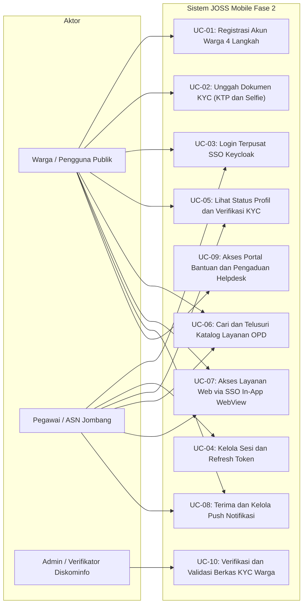
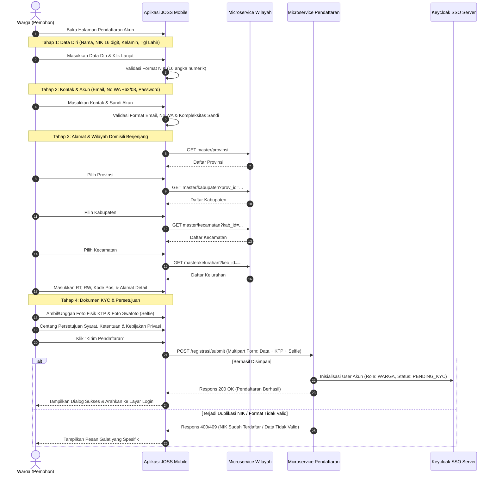
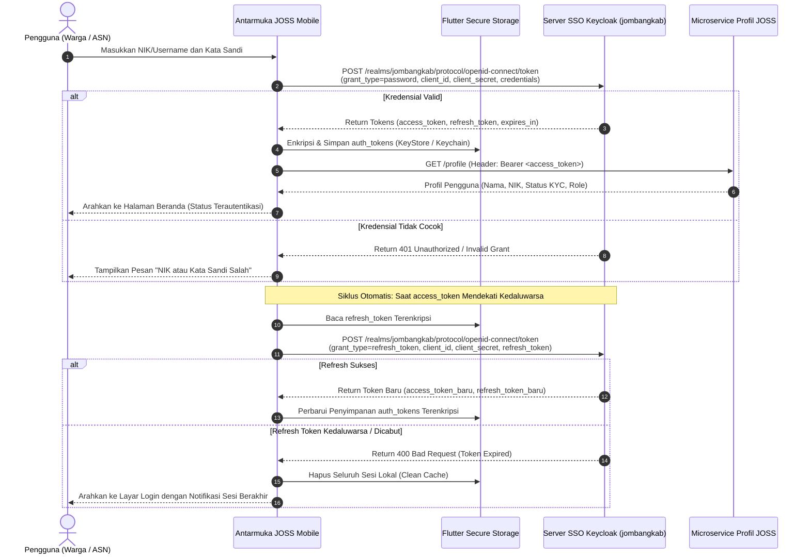
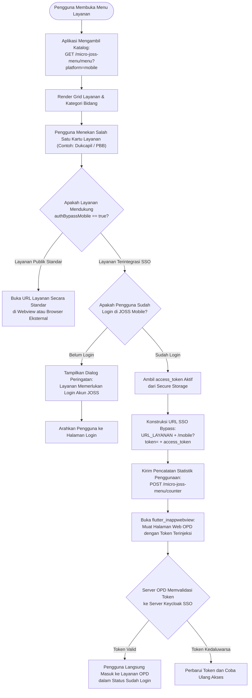
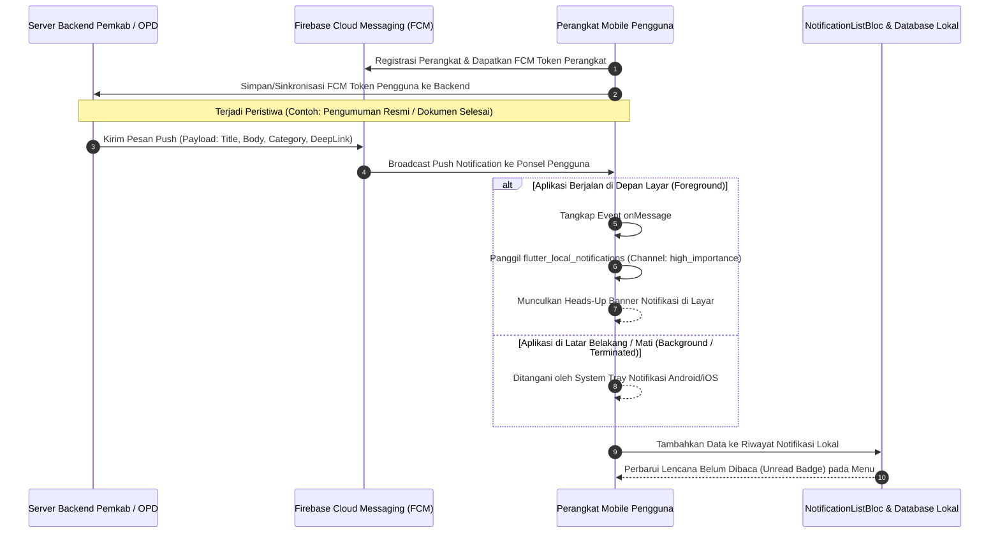
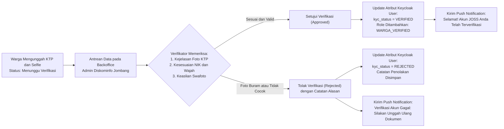
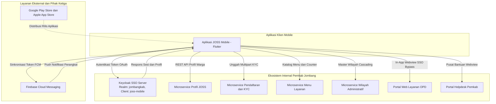

# BUSINESS REQUIREMENTS DOCUMENT (BRD) & BLUEPRINT PROSES BISNIS
## APLIKASI JOSS MOBILE (JOMBANG ONE STOP SERVICE) - FASE 2

**Versi Dokumen:** 1.0 (Final Draft)  
**Tanggal Dokumen:** 12 Oktober 2026  
**Dibuat Oleh:** Tim Pengembang & Tim Analis Sistem (Business Analyst) JOSS Mobile  
**Nama Aplikasi:** JOSS Mobile (Jombang One Stop Service Mobile)  
**Instansi Pemilik:** Dinas Komunikasi dan Informatika Kabupaten Jombang  

---

## RIWAYAT REVISI DOKUMEN

| Versi Dokumen | Tanggal | Penyusun Revisi | Keterangan Perubahan | Nomer Dokumen Revisi |
|---|---|---|---|---|
| 1.0 | 12 Oktober 2026 | Tim Analis Sistem & Solusi TI | Penyusunan draf final BRD, Proses Bisnis (As-Is & To-Be), Arsitektur Fitur, dan Blueprint Teknis JOSS Mobile Fase 2 | BRD-JOSS-MOB-2026-V1.0 |

> [!WARNING]
> **Panduan Change Request (Perubahan Tengah Jalan):** Jika terdapat penyesuaian fungsionalitas, parameter API, atau regulasi pasca-kickoff, naikkan nomor versi dokumen di atas. Pada bab proses bisnis/aturan yang terdampak, sematkan penanda khusus seperti `🆕 [UPDATE v1.1 - Judul Perubahan]` guna mempermudah pelacakan implementasi oleh tim pengembang dan verifikasi QA.

---

## DAFTAR ISI
- [RIWAYAT REVISI DOKUMEN](#riwayat-revisi-dokumen)
- [1. LATAR BELAKANG](#1-latar-belakang)
- [2. TUJUAN PENYUSUNAN BRD](#2-tujuan-penyusunan-brd)
  - [2.1. Acuan Kebutuhan Bisnis Pengembangan Aplikasi](#21-acuan-kebutuhan-bisnis-pengembangan-aplikasi)
  - [2.2. Dasar Penyusunan SRS dan Pengembangan Teknis](#22-dasar-penyusunan-srs-dan-pengembangan-teknis)
- [3. RUANG LINGKUP DOKUMEN](#3-ruang-lingkup-dokumen)
  - [3.1. Batasan Fungsional & Pembagian Tanggung Jawab Deliverables](#31-batasan-fungsional--pembagian-tanggung-jawab-deliverables)
  - [3.2. Batasan Implementasi Teknis](#32-batasan-implementasi-teknis)
- [4. DASAR HUKUM DAN KEBIJAKAN](#4-dasar-hukum-dan-kebijakan)
  - [4.1. Regulasi Nasional](#41-regulasi-nasional)
  - [4.2. Regulasi Daerah](#42-regulasi-daerah)
  - [4.3. Standar Teknis dan Keamanan](#43-standar-teknis-dan-keamanan)
- [5. PROFIL LAYANAN](#5-profil-layanan)
- [6. DESKRIPSI SINGKAT APLIKASI](#6-deskripsi-singkat-aplikasi)
  - [6.1. Peran Fungsional Aplikasi](#61-peran-fungsional-aplikasi)
- [7. PEMANGKU KEPENTINGAN (STAKEHOLDER)](#7-pemangku-kepentingan-stakeholder)
- [8. KONDISI EKSISTING (AS-IS)](#8-kondisi-eksisting-as-is)
  - [8.1. Alur Layanan Saat Ini](#81-alur-layanan-saat-ini)
  - [8.2. Permasalahan yang Terjadi](#82-permasalahan-yang-terjadi)
- [9. PROSES BISNIS YANG DIUSULKAN (TO-BE)](#9-proses-bisnis-yang-diusulkan-to-be)
  - [9.1. Alur Layanan Setelah Digitalisasi](#91-alur-layanan-setelah-digitalisasi)
  - [9.2. Perubahan Signifikan dari Kondisi Eksisting](#92-perubahan-signifikan-dari-kondisi-eksisting)
- [10. DIAGRAM PROSES BISNIS & BLUEPRINT ALUR](#10-diagram-proses-bisnis--blueprint-alur)
  - [10.1. Use Case Diagram](#101-use-case-diagram)
  - [10.2. Alur Proses Pendaftaran Warga & Unggah Dokumen KYC](#102-alur-proses-pendaftaran-warga--unggah-dokumen-kyc)
  - [10.3. Alur Proses Autentikasi Terpusat SSO Keycloak & Refresh Token](#103-alur-proses-autentikasi-terpusat-sso-keycloak--refresh-token)
  - [10.4. Alur Proses Akses Katalog Layanan & In-App Webview SSO Bypass Gateway](#104-alur-proses-akses-katalog-layanan--in-app-webview-sso-bypass-gateway)
  - [10.5. Alur Proses Notifikasi Terpadu (FCM Push & Local Notification)](#105-alur-proses-notifikasi-terpadu-fcm-push--local-notification)
  - [10.6. Alur Verifikasi & Pengesahan Status KYC Warga](#106-alur-verifikasi--pengesahan-status-kyc-warga)
- [11. TUJUAN PENGEMBANGAN APLIKASI](#11-tujuan-pengembangan-aplikasi)
  - [11.1. Tujuan Strategis](#111-tujuan-strategis)
  - [11.2. Tujuan Operasional](#112-tujuan-operasional)
- [12. MANFAAT PENGEMBANGAN](#12-manfaat-pengembangan)
  - [12.1. Manfaat Bagi Masyarakat](#121-manfaat-bagi-masyarakat)
  - [12.2. Manfaat Bagi ASN dan Perangkat Daerah (OPD)](#122-manfaat-bagi-asn-dan-perangkat-daerah-opd)
  - [12.3. Manfaat Bagi Pimpinan Daerah & Tata Kelola SPBE](#123-manfaat-bagi-pimpinan-daerah--tata-kelola-spbe)
- [13. IDENTIFIKASI & DAFTAR KEBUTUHAN SISTEM](#13-identifikasi--daftar-kebutuhan-sistem)
  - [13.1. Pemetaan Pekerjaan Utama: Tim Pengembang MBO (Konsultan)](#131-pemetaan-pekerjaan-utama-tim-pengembang-mbo-konsultan)
  - [13.2. Pemetaan Tugas Rumah (PR): Tim Programmer Diskominfo Kabupaten Jombang](#132-pemetaan-tugas-rumah-pr-tim-programmer-diskominfo-kabupaten-jombang)
  - [13.3. Matriks Kebutuhan Fungsional Lengkap (FR-01 s/d FR-27)](#133-matriks-kebutuhan-fungsional-lengkap-fr-01-sd-fr-27)
- [14. ATURAN BISNIS (BUSINESS RULES)](#14-aturan-bisnis-business-rules)
  - [14.1. Aturan Identitas, Akun & Registrasi KYC](#141-aturan-identitas-akun--registrasi-kyc)
  - [14.2. Aturan Keamanan Sesi, Token & Enkripsi Kredensial](#142-aturan-keamanan-sesi-token--enkripsi-kredensial)
  - [14.3. Aturan Akses Katalog & SSO In-App WebView Bypass](#143-aturan-akses-katalog--sso-in-app-webview-bypass)
  - [14.4. Aturan Penyiaran Notifikasi & Kanal Pengaduan](#144-aturan-penyiaran-notifikasi--kanal-pengaduan)
- [15. JENIS PENGGUNA](#15-jenis-pengguna)
- [16. HAK AKSES PENGGUNA](#16-hak-akses-pengguna)
- [17. JENIS DATA YANG DIKELOLA](#17-jenis-data-yang-dikelola)
- [18. PENGELOLAAN DATA PRIBADI (PRIVACY MANAGEMENT)](#18-pengelolaan-data-pribadi-privacy-management)
  - [18.1. Komitmen Perlindungan Data Pribadi](#181-komitmen-perlindungan-data-pribadi)
  - [18.2. Lingkup Data yang Dikelola](#182-lingkup-data-yang-dikelola)
  - [18.3. Prinsip Pemrosesan Data](#183-prinsip-pemrosesan-data)
  - [18.4. Keamanan & Konfidensialitas](#184-keamanan--konfidensialitas)
- [19. INTEGRASI DATA DAN SISTEM](#19-integrasi-data-dan-sistem)
  - [19.1. Integrasi Sistem Internal Pemkab Jombang](#191-integrasi-sistem-internal-pemkab-jombang)
  - [19.2. Integrasi Eksternal & Layanan Pihak Ketiga](#192-integrasi-eksternal--layanan-pihak-ketiga)
- [20. DAMPAK TERHADAP SDM & PROGRAM ALIH PENGETAHUAN (TOT)](#20-dampak-terhadap-sdm--program-alih-pengetahuan-tot)
  - [20.1. Dampak Terhadap SDM Aparatur](#201-dampak-terhadap-sdm-aparatur)
  - [20.2. Peningkatan Efisiensi Kerja Operasional](#202-peningkatan-efisiensi-kerja-operasional)
  - [20.3. Transformasi Peran & Tanggung Jawab](#203-transformasi-peran--tanggung-jawab)
  - [20.4. Program Transfer Knowledge & Evaluasi Teknis Mandiri](#204-program-transfer-knowledge--evaluasi-teknis-mandiri)
- [21. DAMPAK TERHADAP REGULASI DAN STANDAR OPERASIONAL PROSEDUR (SOP)](#21-dampak-terhadap-regulasi-dan-standar-operasional-prosedur-sop)
- [22. ANALISIS RISIKO BISNIS DAN MITIGASI](#22-analisis-risiko-bisnis-dan-mitigasi)
- [23. KRITERIA KEBERHASILAN (KEY PERFORMANCE INDICATORS)](#23-kriteria-keberhasilan-key-performance-indicators)
- [24. KESIMPULAN DAN REKOMENDASI](#24-kesimpulan-dan-rekomendasi)
  - [24.1. Kesimpulan Eksekutif](#241-kesimpulan-eksekutif)
  - [24.2. Rekomendasi Taktis & Strategis](#242-rekomendasi-taktis--strategis)
- [25. PENUTUP](#25-penutup)

---

## 1. LATAR BELAKANG

Penyelenggaraan Sistem Pemerintahan Berbasis Elektronik (SPBE) di lingkungan Pemerintah Kabupaten Jombang menuntut transformasi digital yang berfokus pada integrasi, kemudahan akses, dan perlindungan data terpadu bagi masyarakat dan aparatur sipil negara. Saat ini, berbagai Organisasi Perangkat Daerah (OPD) di Kabupaten Jombang telah membangun inovasi aplikasi layanan publik berbasis web secara mandiri (seperti portal kependudukan Dukcapil, perizinan, perpajakan daerah/PBB, hingga sistem kepegawaian Simpeg).

Meskipun pada Fase 1 telah diinisiasi portal web JOSS (*Jombang One Stop Service*) dan mesin Single Sign-On (SSO) berbasis Keycloak, penetrasi pemanfaatan layanan di tingkat masyarakat masih menghadapi berbagai kendala:
1. **Fragmentasi Akses dan Friksi Autentikasi:** Masyarakat masih harus menghafal banyak tautan situs web OPD dan berulang kali melakukan pendaftaran serta mengingat kombinasi *username* dan *password* yang berbeda-beda.
2. **Ketiadaan Saluran Mobile Terintegrasi (Cross-Platform Native Experience):** Sebagian besar masyarakat Kabupaten Jombang mengakses internet melalui telepon pintar (*smartphone* Android dan iOS), sedangkan akses via browser peramban desktop kerap terkendala adaptasi antarmuka yang kurang responsif.
3. **Keterbatasan Saluran Komunikasi Real-Time:** Warga belum mendapatkan pemberitahuan seketika (*push notification*) terkait status permohonan layanan, jadwal pelayanan jemput bola, maupun pengumuman gawat darurat daerah langsung ke perangkat genggam.
4. **Verifikasi Identitas Digital yang Belum Baku:** Diperlukan mekanisme pendaftaran terstruktur yang dilengkapi validasi *Know Your Customer* (KYC digital melalui verifikasi NIK, foto KTP, dan swafoto wajah) guna menjamin validitas pemohon layanan publik tanpa harus datang langsung secara fisik ke kantor dinas.

Oleh karena itu, pembangunan aplikasi **JOSS Mobile (Fase 2)** menjadi inisiatif strategis yang mendesak. JOSS Mobile dirancang sebagai *Super-App* gerbang tunggal (*Single Window*) yang mengintegrasikan seluruh layanan publik OPD Kabupaten Jombang di bawah satu identitas digital terverifikasi berbasis Keycloak SSO, arsitektur *Clean Architecture* Flutter, serta gerbang *In-App WebView SSO Bypass*.

---

## 2. TUJUAN PENYUSUNAN BRD

Dokumen *Business Requirements Document* (BRD) ini disusun sebagai cetak biru resmi yang merinci kebutuhan bisnis, operasional, fungsional, dan arsitektural dari aplikasi JOSS Mobile.

### 2.1. Acuan Kebutuhan Bisnis Pengembangan Aplikasi
Dokumen ini berfungsi sebagai:
1. **Penetapan Sasaran Strategis:** Menyelaraskan visi pimpinan Pemerintah Kabupaten Jombang dan Dinas Komunikasi dan Informatika dalam mewujudkan ekosistem digital Satu Pintu.
2. **Penyelarasan Ekspektasi Stakeholder:** Menjadi landasan persetujuan bersama antara Diskominfo Kabupaten Jombang, OPD penyedia layanan, pemangku kepentingan administratif, serta tim teknis pengembang.
3. **Pengendalian Ruang Lingkup (*Scope Management*):** Mengunci batasan fungsionalitas dan jadwal rilis kerja agar tidak terjadi perluasan cakupan yang tidak terkendali (*scope creep*).

### 2.2. Dasar Penyusunan SRS dan Pengembangan Teknis
Bagi tim arsitek perangkat lunak, *lead developer*, dan analis kualitas (QA), dokumen ini menjadi acuan definitif dalam:
1. Penyusunan dokumen teknis *Software Requirements Specification* (SRS) dan *System Architecture Document* (SAD).
2. Perancangan skema kontrak API (RESTful endpoints), model data DTO, serta alur penanganan state pada BLoC.
3. Pembuatan skenario pengujian fungsional (*User Acceptance Testing* / UAT) serta audit kepatuhan keamanan informasi.

---

## 3. RUANG LINGKUP DOKUMEN

### 3.1. Batasan Fungsional & Pembagian Tanggung Jawab Deliverables

Sesuai dengan kesepakatan pembagian tugas kerja (*Responsibility Assignment Matrix*):

#### A. Lingkup Pekerjaan Utama Tim Pengembang MBO (Konsultan):
Mengacu pada spesifikasi kesenjangan arsitektur mobile pada berkas [FITUR_DAN_API.md](file:///d:/sso_jos/FITUR_DAN_API.md):
1. **Rancang Bangun Flutter Mobile App:** Membangun antarmuka dan *business logic* berbasis *Clean Architecture* dan *BLoC Pattern* untuk Android dan iOS.
2. **Autentikasi SSO Keycloak Terpusat:** Integrasi alur login OAuth 2.0 ROPC grant (`sso-v2.jombangkab.go.id`), auto-login, auto-refresh token, profil akun, dan logout.
3. **Pendaftaran Warga & e-KYC 4 Tahap:** Formulir 4 langkah (Data diri, Kontak WA `+62`/`08`, Alamat cascading, Unggah berkas KTP & Selfie) serta integrasi multipart ke `micro-joss-daftar`.
4. **Cascading Master Wilayah:** Integrasi API wilayah bertingkat dari `micro-wilayah-administratif` (Provinsi $\rightarrow$ Kabupaten $\rightarrow$ Kecamatan $\rightarrow$ Kelurahan).
5. **Katalog Layanan & Pelacak Akses:** Integrasi direktori menu dan kategori dari `micro-joss-menu`, pencarian real-time, dan pencatatan metrik klik via `POST /counter`.
6. **In-App WebView SSO Gateway:** Wadah peramban aman (`flutter_inappwebview`) dengan injeksi token otomatis (`/mobile?token=<access_token>`) saat `authBypassMobile == true`.
7. **Penerima Push & Local Notification:** Integrasi Firebase Messaging (FCM), registrasi token perangkat, penanganan *high importance channel* lokal, dan UI Pusat Riwayat Notifikasi.
8. **Keamanan Perangkat Keras:** Enkripsi kredensial pada Android KeyStore / iOS Keychain via `flutter_secure_storage` serta pengaburan rahasia klien Keycloak via `envied`.
9. **Alih Pengetahuan (ToT):** Pelaksanaan transfer of knowledge teknis kepada tim programmer Diskominfo Jombang.

#### B. Lingkup Prasyarat & Tugas Rumah (PR) Tim Programmer Diskominfo Jombang:
Mengacu pada hasil isian kuesioner oleh Kabid Aptika:
1. **Penyediaan Backend API E-Office:** Menyediakan REST API presensi, catatan aktivitas, input tugas harian, approval bawahan, dan rincian TPP bulanan ASN.
2. **Penyediaan Backend Dispatcher Notifikasi:** Menyiapkan database relasi user-to-device token dan modul backend pengirim notifikasi dari server Pemkab ke Firebase FCM.
3. **Penyediaan Data Master Kontak Darurat:** Menyiapkan daftar nomor Call Center 112 Jombang Siaga, RSUD, Damkar, BPBD, dan hotline dinas untuk fitur Button Telepon.
4. **Penyediaan Endpoint REST API Berita Daerah:** Membuka endpoint JSON berita resmi dari portal `jombangkab.go.id`.
5. **Penyediaan Master Data Point-of-Interest (POI):** Menyediakan database fasilitas publik dan objek wisata (nama, alamat, koordinat GPS, foto).
6. **Penyesuaian Aplikasi Web Eksisting OPD:** Mengaktifkan rute penangkap `/mobile?token=...` pada web E-Office, E-Monev, E-Cloud, dan Talenta.
7. **Sinkronisasi User Mapping di Database OPD:** Menambahkan kolom `keycloak_id` pada tabel user di database lokal aplikasi masing-masing OPD.
8. **Akun Toko Aplikasi Instansi:** Menyelesaikan pendaftaran dan verifikasi akun Google Play Console & Apple Developer Program atas nama Pemkab Jombang.

*Pengecualian (Out-of-Scope pada Tim MBO):* Tim Pengembang MBO tidak memprogram ulang database internal masing-masing aplikasi OPD dari nol, melainkan menjembataninya melalui integrasi katalog, API gateway, dan WebView SSO terenkripsi.

### 3.2. Batasan Implementasi Teknis
1. **Teknologi Klien:** *Cross-platform framework* Flutter (Dart) dengan arsitektur *Clean Architecture* dan *BLoC Pattern*.
2. **Dukungan Sistem Operasi:** Android versi 8.0 (Oreo / API Level 26) ke atas dan Apple iOS versi 13.0 ke atas.
3. **Penyimpanan Kredensial:** *Hardware-backed secure storage* (KeyStore pada Android dan Keychain pada iOS).
4. **Alih Pengetahuan (Transfer of Knowledge / ToT):** Pelaksanaan pelatihan teknis komprehensif (source code Flutter, arsitektur Keycloak, FCM, dan deployment) serta evaluasi kompetensi mandiri bagi tim internal programmer Diskominfo Jombang.

---

## 4. DASAR HUKUM DAN KEBIJAKAN

Pengembangan dan operasionalisasi JOSS Mobile berlandaskan pada regulasi dan standar kebijakan berikut:

### 4.1. Regulasi Nasional
1. **Undang-Undang Nomor 27 Tahun 2022** tentang Pelindungan Data Pribadi (UU PDP).
2. **Undang-Undang Nomor 1 Tahun 2024** tentang Perubahan Kedua atas UU Nomor 11 Tahun 2008 tentang Informasi dan Transaksi Elektronik (UU ITE).
3. **Peraturan Presiden Nomor 95 Tahun 2018** tentang Sistem Pemerintahan Berbasis Elektronik (SPBE).
4. **Peraturan Presiden Nomor 39 Tahun 2019** tentang Satu Data Indonesia.
5. **Peraturan Menteri Pendayagunaan Aparatur Negara dan Reformasi Birokrasi Nomor 59 Tahun 2020** tentang Pedoman Evaluasi SPBE.

### 4.2. Regulasi Daerah
1. **Peraturan Bupati Jombang Nomor 61 Tahun 2021** tentang Penyelenggaraan Sistem Pemerintahan Berbasis Elektronik di Lingkungan Pemerintah Kabupaten Jombang.
2. **Kerangka Acuan Kerja (KAK) Pengembangan Aplikasi JOSS Mobile (Fase 2)** pada Dinas Komunikasi dan Informatika Kabupaten Jombang Tahun Anggaran 2026.

### 4.3. Standar Teknis dan Keamanan
1. **Peraturan Badan Siber dan Sandi Negara (BSSN) Nomor 4 Tahun 2021** tentang Pedoman Manajemen Keamanan Informasi SPBE dan Standar Penanganan Insiden Siber (CSIRT).
2. **Standar Keamanan OWASP Mobile Application Security Verification Standard (MASVS)** untuk perlindungan penyimpanan lokal, lalu lintas jaringan HTTPS (TLS 1.3), dan pencegahan manipulasi biner.

---

## 5. PROFIL LAYANAN

* **Nama Layanan:** JOSS Mobile (*Jombang One Stop Service Mobile*)
* **Pemilik Layanan (Service Owner):** Pemerintah Kabupaten Jombang
* **Unit Kerja Pengelola:** Dinas Komunikasi dan Informatika (Diskominfo) Kabupaten Jombang
* **Pejabat Pembuat Komitmen (PPK):** R. Witcaksono Setyo Putro (Kepala Bidang Aplikasi Informatika Diskominfo Kabupaten Jombang)
* **Lokasi Implementasi:** Wilayah Administratif Kabupaten Jombang, Jawa Timur
* **Kategori Layanan:** Portal Layanan Publik Terpadu & Administrasi Pemerintahan (G2C - *Government to Citizen*, G2E - *Government to Employee*, G2B - *Government to Business*)
* **Sumber Pendanaan:** Anggaran Pendapatan dan Belanja Daerah (APBD) Kabupaten Jombang TA 2026

---

## 6. DESKRIPSI SINGKAT APLIKASI

**JOSS Mobile** adalah aplikasi portal cerdas satu pintu (*One-Stop Digital Portal*) berbasis mobile untuk masyarakat dan aparatur sipil negara di Kabupaten Jombang. Aplikasi ini berfungsi sebagai gerbang tunggal identitas digital yang menyatukan katalog layanan publik OPD, verifikasi identitas warga (e-KYC), pengumuman resmi daerah, serta akses langsung ke aplikasi web pemerintahan daerah tanpa perlu mengingat banyak akun melalui integrasi *Single Sign-On* (SSO Keycloak).

### 6.1. Peran Fungsional Aplikasi
1. **Identity & Authentication Provider:** Menjadi instrumen autentikasi terpusat yang aman dengan dukungan OAuth 2.0, manajemen token terenkripsi, dan integrasi data profil ASN/Masyarakat.
2. **Digital Citizen Hub:** Menyediakan fasilitas pendaftaran akun warga, verifikasi identitas kependudukan digital, serta pelacakan status validasi data.
3. **Service Aggregator & Discovery:** Mengonsolidasikan puluhan layanan sektoral OPD (Administrasi Kependudukan, Kesehatan, Perpajakan, Perizinan, Pengaduan, dll.) ke dalam direktori terstruktur dan pencarian instan.
4. **Seamless Gateway (SSO Bypass):** Membuka aplikasi web berbasis domain Pemerintah Kabupaten Jombang di dalam wadah *In-App WebView* yang secara otomatis menyuntikkan token otorisasi pengguna.
5. **Government-to-Citizen Broadcaster:** Menyampaikan informasi kedinasan, siaran pers pimpinan daerah, serta notifikasi individual secara cepat dan aman melalui *push notification*.

---

## 7. PEMANGKU KEPENTINGAN (STAKEHOLDER)

| No | Stakeholder | Peran Utama | Kepentingan & Ekspektasi |
|:---:|---|---|---|
| 1 | **Pimpinan Daerah (Bupati & Sekda Jombang)** | Pembina Kebijakan & Sponsor Utama | Mewujudkan tata kelola SPBE modern, meningkatkan indeks kepuasan publik, serta memiliki instrumen komunikasi cepat dengan warga. |
| 2 | **Diskominfo Kab. Jombang (Bidang Aptika)** | Pengelola Teknis & *Service Owner* | Menjaga kestabilan infrastruktur server SSO, mengelola pendaftaran akun, mengawasi integrasi API, dan mengelola rilis aplikasi mobile. PPK: Bapak R. Witcaksono Setyo Putro. |
| 3 | **Tim Programmer Diskominfo (Sdr. Irfan & Tim)** | Pelaksana Teknis Internal (Backend & DB) | Menuntaskan Tugas Rumah (PR): menyediakan backend API E-Office, push notifikasi, kontak darurat 112, feed berita daerah, master POI, dan sinkronisasi database OPD. |
| 4 | **Diskominfo Kab. Jombang (Bidang IKP)** | Pengelola Konten & Informasi Daerah | Mendistribusikan berita resmi daerah, siaran pers, dan banner pengumuman agenda pembangunan ke pengguna aplikasi. |
| 5 | **Perangkat Daerah (OPD) Pemkab Jombang** | Penyedia Layanan Sektoral (Service Providers) | Memperoleh saluran distribusi digital mobile dan menyesuaikan web eksisting agar mendukung integrasi SSO bypass `/mobile?token=...`. |
| 6 | **Masyarakat Kabupaten Jombang** | Pengguna Akhir Publik (*Citizen End-User*) | Kemudahan mengakses layanan publik kapan saja dan di mana saja, bebas antrean, satu akun untuk semua urusan, dan kepastian perlindungan privasi. |
| 7 | **Pegawai / ASN Pemkab Jombang** | Pengguna Internal (*Internal Employee*) | Kemudahan mengakses modul kepegawaian E-Office native, presensi, aktivitas, dan layanan internal kedinasan dengan otorisasi NIP otomatis. |
| 8 | **Tim Pengembang MBO (Konsultan)** | Pelaksana Pengembangan Inti Mobile & ToT | Merealisasikan seluruh arsitektur mobile Flutter di [FITUR_DAN_API.md](file:///d:/sso_jos/FITUR_DAN_API.md), menyelesaikan integrasi API, memfasilitasi publikasi store, dan mentransfer pengetahuan teknis. |
| 9 | **Jombangkab-CSIRT & Tim Keamanan Informasi** | Pengawas Keamanan Siber | Menjamin kerahasiaan data kependudukan, pengujian penetrasi (*penetration test*), dan pemenuhan regulasi UU PDP. |

---

## 8. KONDISI EKSISTING (AS-IS)

### 8.1. Alur Layanan Saat Ini
Pada kondisi berjalan saat ini, proses pemanfaatan layanan digital pemerintahan di Kabupaten Jombang digambarkan sebagai berikut:
1. Warga yang membutuhkan layanan publik (misalnya permohonan akta kependudukan, pengecekan PBB, atau konsultasi perizinan) harus mencari dan membuka situs web masing-masing OPD secara terpisah melalui peramban.
2. Di setiap situs web OPD, pengguna diwajibkan melakukan registrasi manual akun lokal baru, mengisi ulang data identitas (NIK, Nama, Alamat), dan mengingat kombinasi kata sandi yang berlainan.
3. Meskipun portal web JOSS Fase 1 telah menyediakan SSO untuk beberapa situs web, akses pengguna yang menggunakan ponsel pintar sering terhambat oleh tata letak web yang belum responsif serta ketidakmampuan peramban mobile dalam mempertahankan sesi secara aman.
4. Pemberitahuan status pengajuan dokumen sebagian besar masih mengandalkan pesan SMS manual, pengecekan berkala secara mandiri ke situs web, atau kehadiran fisik ke loket kantor dinas.

### 8.2. Permasalahan yang Terjadi
Berdasarkan evaluasi terhadap kondisi eksisting, teridentifikasi sejumlah kendala kritikal (*pain points*):
* **Fragmentasi Akun (Account Silos):** Masyarakat mengeluhkan kejenuhan registrasi (*registration fatigue*) akibat banyaknya akun yang harus dibuat pada sistem OPD yang terpisah.
* **Risiko Keamanan Kredensial:** Pengguna cenderung menggunakan kata sandi yang lemah dan berulang di berbagai situs web OPD, meningkatkan kerentanan pencurian data identitas.
* **Tingginya Beban Verifikasi Manual:** Setiap OPD harus memverifikasi keabsahan KTP pemohon secara berulang-ulang karena belum tersedianya repositori KYC terpusat tingkat kabupaten.
* **Ketiadaan Saluran Responsif Real-Time:** Ketiadaan mekanisme *Push Notification* berbasis OS membuat masyarakat sering terlambat mengetahui bahwa berkas permohonannya membutuhkan perbaikan atau telah selesai diproses.
* **Kesenjangan Kapabilitas Pemeliharaan Internal:** Tim teknis internal Diskominfo di masa lalu mengalami kendala dalam memperluas ekosistem mobile karena keterbatasan dokumentasi arsitektur dan belum tuntasnya proses alih pengetahuan (*transfer of knowledge*).

---

## 9. PROSES BISNIS YANG DIUSULKAN (TO-BE)

### 9.1. Alur Layanan Setelah Digitalisasi
Dengan diterapkannya aplikasi JOSS Mobile Fase 2, transformasi proses bisnis diarahkan ke model pelayanan satu pintu terpadu:
1. **Satu Akun Terverifikasi untuk Seluruh Layanan:** Pengguna cukup melakukan satu kali pendaftaran di JOSS Mobile dengan alur 4 tahap terstandarisasi. Data diverifikasi secara terpadu melalui e-KYC (KTP & swafoto) yang langsung terhubung ke Keycloak SSO.
2. **Katalog Cerdas & Akses Langsung (Single Window):** Pengguna dapat mencari seluruh katalog layanan OPD dari beranda aplikasi JOSS Mobile. Saat layanan dipilih, aplikasi mengaktifkan gerbang *In-App WebView SSO Gateway* yang secara otomatis menyuntikkan token otentikasi aktif (`?token=<access_token>`), sehingga pengguna langsung masuk ke halaman layanan OPD tanpa perlu login ulang.
3. **Penyampaian Informasi & Notifikasi Proaktif:** Pembaruan status verifikasi akun, pengumuman daerah, dan tindak lanjut permohonan dikirimkan secara seketika melalui *Push Notification* langsung ke layar ponsel pintar pengguna.
4. **Keamanan Bertingkat & Enkripsi Kredensial:** Token autentikasi dan kunci sesi disimpan di dalam brankas perangkat terenkripsi (*EncryptedSharedPreferences / Keychain*), sementara kode rahasia aplikasi disamarkan (*obfuscated*) menggunakan library C/Dart biner untuk menangkal serangan dekompilasi.

### 9.2. Perubahan Signifikan dari Kondisi Eksisting

| Dimensi Analisis | Kondisi Eksisting (*As-Is*) | Kondisi Diusulkan (*To-Be*) |
|---|---|---|
| **Akses Saluran** | Tersebar di berbagai situs web peramban desktop yang belum ramah layar sentuh ponsel. | Terpusat dalam satu aplikasi *Cross-Platform Mobile App* (Flutter) untuk Android & iOS yang modern dan intuitif. |
| **Mekanisme Login** | Multi-login; pengguna membuat dan menghafal *username/password* berbeda di tiap OPD. | *Single Sign-On (SSO)* terpusat berbasis Keycloak OAuth 2.0; satu akun untuk seluruh layanan daerah. |
| **Pendaftaran & KYC** | Pengisian formulir manual berulang di tiap dinas; verifikasi KTP fisik di loket pelayanan. | Pendaftaran terpadu 4 langkah dengan validasi berjenjang master wilayah dan unggah dokumen digital e-KYC (KTP + selfie). |
| **Akses Aplikasi OPD** | Pengguna keluar dari portal dan login ulang secara manual di situs web OPD terkait. | *Seamless In-App WebView SSO Gateway*; sistem menyuntikkan token autentikasi aktif secara otomatis. |
| **Kanal Notifikasi** | Bergantung pada SMS manual atau pengguna harus mengecek situs web dinas secara berkala. | *Real-Time Push Notification* melalui Firebase Cloud Messaging (FCM) dan pusat notifikasi terfilter di aplikasi. |
| **Penyimpanan Kredensial** | Disimpan pada penyimpanan lokal peramban (*localStorage / cookies*) yang rentan skrip XSS. | Disimpan di dalam brankas perangkat terenkripsi tingkat perangkat keras (*flutter_secure_storage* / Keychain / KeyStore). |
| **Kemandirian SDM Daerah**| Ketergantungan tinggi pada konsultan eksternal pasca-serah-terima sistem. | Penguasaan penuh oleh programmer internal Diskominfo melalui program *Transfer of Knowledge (ToT)* dan uji kompetensi. |

---

## 10. DIAGRAM PROSES BISNIS & BLUEPRINT ALUR

Dokumen ini memetakan seluruh interaksi fungsional antara pengguna, antarmuka mobile JOSS, gateway API, microservice daerah, serta server Keycloak SSO melalui standar visual diagram terstruktur.

### 10.1. Use Case Diagram

#### Tabel Pemetaan Use Case Fungsional

| Kode Use Case | Nama Use Case | Aktor Terlibat | Deskripsi Interaksi Fungsional |
|---|---|---|---|
| `UC-01` | Registrasi Akun Warga 4 Langkah | Calon Pengguna (Warga) | Calon pengguna memasukkan NIK, data diri, kontak WhatsApp, kata sandi, dan memilih wilayah administratif secara berjenjang. |
| `UC-02` | Unggah Dokumen KYC | Calon Pengguna (Warga) | Pengguna mengambil foto KTP fisik dan swafoto wajah langsung dari kamera ponsel atau galeri dan mengunggahnya ke server pendaftaran. |
| `UC-03` | Login Terpusat SSO Keycloak | Warga & ASN | Pengguna memasukkan kredensial (NIK/Username dan Password). Sistem melakukan pertukaran token ke server Keycloak via ROPC grant. |
| `UC-04` | Kelola Sesi & Refresh Token | Sistem (Internal) & Pengguna | Aplikasi secara proaktif memperbarui *access token* yang hampir kedaluwarsa menggunakan *refresh token* tanpa memutus alur pengguna. |
| `UC-05` | Lihat Status Profil & Akun KYC | Warga & ASN | Pengguna memeriksa lencana status verifikasi (Belum Terverifikasi, Menunggu, Terverifikasi, Ditolak) pada kartu profil dan banner beranda. |
| `UC-06` | Cari & Telusuri Katalog Layanan | Warga & ASN | Pengguna mencari layanan publik berdasarkan kata kunci, kategori dinas, atau memilih dari grid 8 layanan paling populer di Jombang. |
| `UC-07` | Akses Layanan via SSO In-App WebView | Warga & ASN | Pengguna membuka layanan web dinas langsung di dalam aplikasi; sistem menyuntikkan token aktif sehingga layanan terbuka dalam status terotentikasi. |
| `UC-08` | Terima & Kelola Notifikasi | Warga & ASN | Pengguna menerima pemberitahuan instan FCM pada status bar perangkat serta dapat membaca riwayat pengumuman di Pusat Notifikasi. |
| `UC-09` | Akses Portal Bantuan Helpdesk | Warga & ASN | Pengguna mengakses pusat bantuan, FAQ, dan kanal Helpdesk Pemkab Jombang secara langsung dari menu pengaturan/sidebar. |
| `UC-10` | Verifikasi Berkas KYC Warga | Admin / Verifikator Diskominfo | Petugas Diskominfo memeriksa kecocokan data NIK, foto KTP, dan swafoto pemohon pada dashboard admin web lalu memberikan status pengesahan. |

---

### 10.2. Alur Proses Pendaftaran Warga & Unggah Dokumen KYC

Diagram aktivitas ini menggambarkan tata cara calon pengguna melakukan pendaftaran akun baru secara berurutan melewati 4 tahapan formulir dinamis hingga data tersimpan di `micro-joss-daftar`.

#### Rincian Langkah Operasional Registrasi

| Fase Operasional | Aksi Pengguna & Validasi Sistem | Parameter Kunci / Endpoint Terkait | Status Akhir |
|---|---|---|---|
| **Langkah 1: Identitas Pribadi** | Pengguna menginput Nama Lengkap, NIK, Jenis Kelamin, dan Tanggal Lahir. Sistem memvalidasi panjang NIK wajib tepat 16 digit numerik. | Client-side Regex: `^[0-9]{16}$` | Data tersimpan di memory state `RegistrationBloc`. |
| **Langkah 2: Informasi Akun** | Pengguna menginput Alamat Email aktif, Nomor WhatsApp, dan Kata Sandi (minimal 8 karakter). Sistem menormalkan nomor WA ke format Indonesia (`+62` / `08`). | Client-side Email & Phone Normalizer | Validasi lolos; berpindah ke Langkah 3. |
| **Langkah 3: Domisili Berjenjang** | Sistem meminta daftar wilayah ke server secara dinamis: Provinsi $\rightarrow$ Kabupaten $\rightarrow$ Kecamatan $\rightarrow$ Kelurahan. Pengguna melengkapi nomor RT, RW, dan alamat jalan. | `GET /master/provinsi` `GET /master/kabupaten` `GET /master/kecamatan` `GET /master/kelurahan` | Objek wilayah terpilih dikaitkan ke data pendaftaran. |
| **Langkah 4: Berkas KYC** | Pengguna mengambil foto KTP dan foto selfie wajah. Pengguna menyetujui pernyataan kebenaran data dan kebijakan privasi. | File image picker (MIME: `.jpg`, `.jpeg`, `.png`, max 5MB) | Form multipart siap dikirim. |
| **Pengiriman & Eksekusi** | Aplikasi mengirim data lengkap beserta berkas fisik via *multipart/form-data* ke microservice pendaftaran. | `POST /registrasi/submit` (Header: `User-Agent: yaak`) | Akun terbentuk di Keycloak; berkas KYC masuk antrean verifikasi. |

---

### 10.3. Alur Proses Autentikasi Terpusat SSO Keycloak & Refresh Token

Blueprint berikut mengilustrasikan alur login pengguna menggunakan protokol OAuth 2.0 Resource Owner Password Credentials (ROPC) grant, penyimpanan token aman, serta siklus hidup peremajaan token (*token refresh cycle*).

#### Rincian Langkah Siklus Autentikasi

| Tahapan Siklus | Entitas Terlibat | Mekanisme & Parameter Keamanan | Hasil / Output |
|---|---|---|---|
| **Pengiriman Kredensial** | `AuthBloc` $\rightarrow$ Keycloak Token Endpoint | `POST /realms/jombangkab/protocol/openid-connect/token` Payload: `grant_type=password`, `client_id=joss-mobile`, `client_secret` (terenkripsi via *envied*), `username`, `password`, `scope=openid offline_access` | Keycloak menerbitkan pasangan JWT token resmi. |
| **Penyimpanan Kredensial** | Data Layer $\rightarrow$ `FlutterSecureStorage` | Kunci sesi disimpan di Android Keystore / iOS Keychain; tidak dapat dibaca oleh aplikasi lain maupun saat backup biasa. | Token aman tersimpan secara persisten. |
| **Pengambilan Profil** | App $\rightarrow$ `micro-joss-profile` | `GET /profile` dengan otorisasi Bearer token. | Data identitas, nama lengkap, dan status lencana ditampilkan di beranda. |
| **Penyegaran Sesi Berkala** | Interceptor Dio / Timer Background | `grant_type=refresh_token`. Dilakukan sebelum token kedaluwarsa tanpa menginterupsi interaksi pengguna. | Masa aktif sesi diperpanjang secara transparan. |
| **Pencabutan Sesi (Logout)** | App $\rightarrow$ Keycloak Logout Endpoint | `POST /realms/jombangkab/protocol/openid-connect/logout` Kredensial lokal di brankas perangkat dihapus bersih. | Sesi di server dicabut; status kembali ke *Unauthenticated*. |

---

### 10.4. Alur Proses Akses Katalog Layanan & In-App Webview SSO Bypass Gateway

Diagram alur berikut menjelaskan bagaimana pengguna menjelajahi direktori layanan publik Kabupaten Jombang, bagaimana sistem mencatat statistik akses warga (*analytics counter*), serta bagaimana mekanisme penyuntikan token (*SSO Bypass*) bekerja saat membuka layanan web OPD di dalam aplikasi.

#### Rincian Langkah Akses Layanan & SSO Bypass

| No | Langkah Alur | Komponen Pelaksana | Deskripsi Rinci |
|---|---|---|---|
| 1 | Pengambilan Direktori | `ServicesBloc` | Mengonsumsi `GET /menu?platform=mobile` dan `GET /menu/kategori` dari *micro-joss-menu*. Menampilkan daftar layanan lengkap beserta ikon resminya. |
| 2 | Deteksi Fitur Bypass | `ServiceEntity` Model | Memeriksa nilai properti `authBypassMobile`. Jika bernilai `true`, layanan membutuhkan identitas pengguna aktif untuk login otomatis. |
| 3 | Validasi Status Pengguna | `AuthBloc` State | Memastikan pengguna telah berstatus `Authenticated`. Jika anonim, aplikasi meminta pengguna login atau registrasi terlebih dahulu. |
| 4 | Injeksi Token Otorisasi | In-App Webview Launcher | Menyusun URL tujuan akhir dengan menyisipkan parameter token resmi: `<service_url>/mobile?token=<access_token>`. |
| 5 | Pencatatan Analitik | Analytics Service | Memanggil endpoint `POST /counter` dengan payload `{"platform": "mobile", "code": "<service_code>"}` guna mencatat metrik frekuensi akses layanan oleh masyarakat. |
| 6 | Penayangan Halaman | `flutter_inappwebview` | Membuka antarmuka aplikasi OPD di dalam jendela peramban aman internal aplikasi yang terisolasi dengan kontrol navigasi kembali (*back button*). |

---

### 10.5. Alur Proses Notifikasi Terpadu (FCM Push & Local Notification)

---

### 10.6. Alur Verifikasi & Pengesahan Status KYC Warga

---

## 11. TUJUAN PENGEMBANGAN APLIKASI

### 11.1. Tujuan Strategis
1. **Perwujudan Ekosistem Satu Pintu (Single Window) SPBE:** Mengintegrasikan seluruh portal layanan sektoral pemerintah daerah ke dalam satu genggaman masyarakat yang terstandardisasi.
2. **Kedaulatan Identitas Digital Masyarakat Jombang:** Membangun basis identitas tunggal (*Single Digital Identity*) yang valid dan aman bagi seluruh penduduk Kabupaten Jombang untuk keperluan transaksi pelayanan publik elektronik.
3. **Peningkatan Indeks Kematangan SPBE Daerah:** Memenuhi indikator evaluasi Kementerian PANRB terkait keterpaduan layanan publik berbasis mobile dan penerapan SSO terintegrasi.
4. **Peningkatan Kepercayaan Publik (Public Trust):** Menyediakan sarana komunikasi dan interaksi resmi antara pemerintah daerah dengan warga secara modern, transparan, dan akuntabel.

### 11.2. Tujuan Operasional
1. **Mengeliminasi Duplikasi Akun:** Menggantikan proses registrasi mandiri di tiap situs web dinas dengan satu akun SSO Keycloak terverifikasi.
2. **Penyediaan Akses Layanan Cepat (Quick Access):** Menyediakan katalog interaktif dan pencarian cerdas yang mengarahkan warga ke layanan yang tepat dalam waktu kurang dari 5 detik.
3. **Efisiensi Waktu Pelayanan Publik:** Menghilangkan keharusan warga datang secara fisik ke kantor dinas hanya untuk verifikasi berkas awal atau sekadar mengetahui informasi status permohonan.
4. **Kemandirian Pengelolaan Teknis Diskominfo:** Memastikan tim programmer internal Diskominfo Jombang memiliki kecakapan penuh dalam memelihara, menguji, dan memperluas fitur aplikasi JOSS Mobile tanpa ketergantungan pada pihak ketiga.

---

## 12. MANFAAT PENGEMBANGAN

### 12.1. Manfaat Bagi Masyarakat
1. **Praktis dan Hemat Waktu:** Cukup mengingat satu akun dan satu aplikasi untuk mengurus seluruh keperluan administrasi kependudukan, perizinan, kesehatan, dan perpajakan di Kabupaten Jombang.
2. **Kemudahan Akses Kapan Saja:** Layanan publik dapat diakses 24 jam sehari, 7 hari seminggu langsung dari perangkat smartphone pribadi.
3. **Kepastian Informasi & Proaktif:** Mendapatkan kabar pembaruan status pengurusan layanan seketika melalui notifikasi perangkat tanpa rasa cemas kehilangan berkas.
4. **Keamanan Data Pribadi Terjamin:** Data identitas (NIK dan dokumen kependudukan) dilindungi dengan standar enkripsi modern sesuai amanat UU PDP.

### 12.2. Manfaat Bagi ASN dan Perangkat Daerah (OPD)
1. **Kanal Distribusi Layanan Siap Pakai:** OPD tidak perlu mengalokasikan anggaran terpisah untuk membangun aplikasi mobile masing-masing; cukup mendaftarkan URL dan API layanan mereka ke dalam JOSS Mobile.
2. **Beban Verifikasi Berkurang:** Pengguna yang mengakses layanan OPD telah melewati verifikasi identitas (e-KYC) di level portal induk JOSS, meminimalkan akun fiktif (*spammer*).
3. **Akses Cepat Bagi ASN:** Pegawai Pemkab Jombang dapat membuka sistem internal kedinasan (seperti portal kepegawaian Simpeg) secara langsung dari perangkat genggam dengan otentikasi NIP otomatis.

### 12.3. Manfaat Bagi Pimpinan Daerah & Tata Kelola SPBE
1. **Visibilitas dan Analitik Nyata (Data-Driven Policy):** Pimpinan daerah memperoleh data statistik pemanfaatan layanan publik secara riil melalui metrik klik dan jumlah pengguna aktif.
2. **Saluran Komunikasi Resmi Langsung:** Sarana sosialisasi kebijakan kepala daerah dan penyiaran informasi darurat (bencana alam, peringatan kesehatan) yang menjangkau puluhan ribu warga secara langsung.
3. **Efisiensi Anggaran TI Daerah:** Menghindari pemborosan belanja modal perangkat lunak (*software duplication*) di lingkungan dinas-dinas otonom.

---

## 13. IDENTIFIKASI & DAFTAR KEBUTUHAN SISTEM

Bab ini merinci hasil pemetaan kebutuhan sistem dan pembagian tanggung jawab teknis secara tegas antara **Pekerjaan Utama Tim Pengembang MBO (Konsultan)** dan **Tugas Rumah (PR) Tim Programmer Diskominfo Kabupaten Jombang**:
1. **Pekerjaan Utama Tim Pengembang MBO:** Merealisasikan seluruh arsitektur, modul aplikasi, keamanan, dan integrasi API yang dirumuskan pada dokumen analisis kesenjangan mobile ([FITUR_DAN_API.md](file:///d:/sso_jos/FITUR_DAN_API.md)).
2. **Tugas Rumah (PR) Tim Programmer Diskominfo Jombang:** Menyiapkan ketersediaan API backend, sinkronisasi database OPD, dan prasyarat akun yang menjadi dependensi dari hasil isian resmi kuesioner pra-kickoff.

---

### 13.1. Pemetaan Pekerjaan Utama: Tim Pengembang MBO (Konsultan)
*Dasar Rujukan: Dokumen Arsitektur & Analisis Kesenjangan Mobile ([FITUR_DAN_API.md](file:///d:/sso_jos/FITUR_DAN_API.md))*

Tim Pengembang MBO bertanggung jawab penuh atas perancangan, pengembangan, pengujian, dan penjaminan kualitas aplikasi **JOSS Mobile (Cross-Platform Flutter)** dari hulu ke hilir:

| No | Modul / Pilar Pekerjaan | Komponen yang Dibangun MBO | Deskripsi Teknis & Output Deliverables |
|:---:|---|---|---|
| **1** | **Fondasi Arsitektur & State Management** | *Clean Architecture* & BLoC Pattern | Membangun struktur 3 lapis (*Presentation, Domain, Data*), *Dependency Injection* (`get_it` & `injectable`), serta penanganan galat fungsional (`fpdart` *Either Failure*). |
| **2** | **Keamanan & Enkripsi Kredensial** | *Secure Storage* & Binarization | Implementasi penyimpanan sesi Keycloak ke *Android KeyStore / iOS Keychain* via `flutter_secure_storage` serta pengaburan kode rahasia (`KEYCLOAK_CLIENT_SECRET`) via `envied`. |
| **3** | **Autentikasi SSO Keycloak Terpusat** | `AuthBloc` & OIDC ROPC Flow | Integrasi login OAuth 2.0 ke `https://sso-v2.jombangkab.go.id`, pengelolaan token (`access_token`, `refresh_token`), *auto-login*, interceptor auto-refresh, dan pencabutan sesi (*logout*). |
| **4** | **Pendaftaran Warga & e-KYC 4 Langkah** | `RegistrationBloc` & `KycBloc` | Membangun alur 4 langkah formulir (Data diri, Kontak WA format `+62`/`08`, Alamat dinamis, Unggah berkas KTP & Selfie) dan integrasi multipart ke `micro-joss-daftar`. |
| **5** | **Integrasi Cascading Master Wilayah** | `WilayahBloc` | Integrasi API hierarkis master wilayah (`micro-wilayah-administratif`) dari Provinsi $\rightarrow$ Kabupaten $\rightarrow$ Kecamatan $\rightarrow$ Kelurahan secara real-time. |
| **6** | **Katalog Menu & Pelacak Akses** | `ServicesBloc` | Menampilkan direktori layanan dan kategori dari `micro-joss-menu`, filter pencarian instan (*real-time search*), serta mencatat analitik klik via `POST /counter`. |
| **7** | **In-App WebView SSO Gateway** | `flutter_inappwebview` | Membuka portal web eksternal/OPD di dalam aplikasi dengan penyuntikan token SSO otomatis (`/mobile?token=<access_token>`) saat `authBypassMobile == true`. |
| **8** | **Penerima Push & Local Notification** | `NotificationBloc` & `NotificationListBloc` | Integrasi Firebase Messaging (FCM), registrasi token perangkat, penanganan *high importance channel* lokal, dan UI Pusat Riwayat Notifikasi. |
| **9** | **Dashboard, UI/UX & Profil Dinamis** | Beranda & AppSidebar Drawer | Antarmuka responsif (Light Mode standar), banner status KYC, grid layanan terpopuler, dan header adaptif profil warga/ASN. |
| **10** | **Alih Pengetahuan (ToT)** | Workshop & Evaluasi Teknis | Melatih programmer Kominfo mengenai pemeliharaan source code Flutter, BLoC, dan manajemen token Keycloak. |

---

### 13.2. Pemetaan Tugas Rumah (PR): Tim Programmer Diskominfo Kabupaten Jombang
*Dasar Rujukan: Isian Resmi Kuesioner oleh Kabid Aptika Diskominfo (R. Witcaksono Setyo Putro)*

Guna mendukung berjalannya modul-modul native dan integrasi portal secara utuh, pihak **Dinas Kominfo Jombang (Sdr. Irfan & Tim Teknis)** memiliki PR untuk menyiapkan aspek backend, database, dan perizinan:

| No | Komponen Kebutuhan | Uraian Tugas Rumah (PR) Tim Diskominfo Jombang | Status Saat Ini | Target Penyelesaian |
|:---:|---|---|:---:|:---:|
| **PR-01** | **Backend API E-Office Native** | Menyediakan endpoint REST API untuk: (1) Rekap presensi pegawai, (2) Catatan aktivitas, (3) Input aktivitas kerja, (4) Verifikasi aktivitas bawahan, dan (5) Rincian TPP bulanan. | Belum Tersedia | Selesai bertahap (Sprint 3–4) |
| **PR-02** | **Backend Dispatcher Push Notifikasi** | Menyiapkan endpoint penyimpan FCM token pengguna (`user_id` / NIK / NIP $\leftrightarrow$ device token) dan modul backend pengirim notifikasi dari server Pemkab ke Firebase. | Belum Tersedia | Sprint 2 |
| **PR-03** | **Data Master Call Center 112 & Kontak** | Menyediakan daftar nomor kontak darurat (Call Center 112 Jombang Siaga, Damkar, BPBD, RSUD, Polisi, dan dinas teknis) untuk modul Button Telepon. | Belum Tersedia | Sprint 1 |
| **PR-04** | **REST API Feed Berita Resmi** | Membuka/menyediakan endpoint JSON berita dari portal `jombangkab.go.id` (judul, thumbnail, kategori, tanggal terbit, konten artikel lengkap). | Belum Tersedia | Sprint 2 |
| **PR-05** | **Data Master & API Point-of-Interest (POI)** | Menyediakan master data titik fasilitas publik dan wisata di Jombang (nama, alamat, koordinat Latitude & Longitude, foto, dan kategori fasilitas). | Belum Tersedia | Sprint 3 |
| **PR-06** | **Penerima SSO Bypass Web OPD** | Menyesuaikan aplikasi web eksisting (E-Office Web, E-Monev, E-Cloud, Talenta) agar mampu menerima parameter `/mobile?token=...`, memvalidasi ke Keycloak, dan membuat sesi login web. | Dalam Penjajakan | Sprint 2–3 |
| **PR-07** | **Sinkronisasi User Mapping Database OPD** | Menambahkan kolom referensi `keycloak_id` atau relasi NIP/NIK pada tabel pengguna di database lokal masing-masing aplikasi OPD. | Dalam Penjajakan | Sprint 2–3 |
| **PR-08** | **Akun Google Play & Apple Developer** | Menyiapkan akun developer organisasi instansi atas nama Pemkab Jombang (verifikasi D-U-N-S Number Apple & Google Play Console) untuk publikasi rilis. | Proses Verifikasi | Sprint 4 |

---

### 13.3. Matriks Kebutuhan Fungsional Lengkap (FR-01 s/d FR-27)

Matriks ini merangkum seluruh fungsionalitas sistem yang menggabungkan implementasi aplikasi mobile oleh MBO dan pemenuhan PR backend oleh Diskominfo:

| Kode Kebutuhan | Nama Fitur / Modul | Deskripsi Fungsionalitas | Penanggung Jawab | Prioritas |
|---|---|---|:---:|:---:|
| **FR-01** | Login SSO Keycloak | Autentikasi OAuth 2.0 ROPC grant ke server Keycloak (`sso-v2.jombangkab.go.id`). | **MBO (Mobile)** | **High** |
| **FR-02** | Refresh Token Otomatis | Peremajaan token transparan di latar belakang sebelum kedaluwarsa. | **MBO (Mobile)** | **High** |
| **FR-03** | Penyimpanan Kredensial Aman | Kredensial sesi disimpan di KeyStore Android / Keychain iOS. | **MBO (Mobile)** | **High** |
| **FR-04** | Pendaftaran Warga 4 Langkah | Formulir registrasi data diri, kontak WA, domisili berjenjang, dan berkas KYC. | **MBO (Mobile)** | **High** |
| **FR-05** | Cascading Master Wilayah | Pengambilan dinamis Provinsi $\rightarrow$ Kabupaten $\rightarrow$ Kecamatan $\rightarrow$ Kelurahan. | **MBO (Mobile)** | **High** |
| **FR-06** | Unggah Dokumen KYC | Kompresi dan upload berkas foto KTP serta foto selfie wajah via multipart. | **MBO (Mobile)** | **High** |
| **FR-07** | Banner & Status KYC | Menampilkan status verifikasi akun (Belum, Menunggu, Terverifikasi, Ditolak). | **MBO (Mobile)** | **High** |
| **FR-08** | Beranda & Profil Dinamis | Sapaan, kartu status KYC, dan tampilan adaptif Nama, NIP, Jabatan, OPD bagi ASN. | **MBO (Mobile)** | **High** |
| **FR-09** | Grid Layanan Populer | Grid 8 pintasan layanan publik paling sering diakses di Kabupaten Jombang. | **MBO (Mobile)** | **High** |
| **FR-10** | Direktori Katalog Layanan | Katalog lengkap layanan OPD terfilter berdasarkan kategori bidang. | **MBO (Mobile)** | **High** |
| **FR-11** | In-App WebView SSO Bypass | Membuka web dinas dengan injeksi token otomatis (`?token=<access_token>`). | **MBO & Kominfo** | **High** |
| **FR-12** | Pelacak Akses (Counter) | Pencatatan statistik klik/akses warga ke `micro-joss-menu/counter`. | **MBO (Mobile)** | **Medium** |
| **FR-13** | Registrasi Token FCM | Mengambil token FCM perangkat dan memperbarui status registrasi. | **MBO & Kominfo** | **High** |
| **FR-14** | Notifikasi Lokal Heads-Up | Menampilkan notifikasi prioritas tinggi saat aplikasi berada di foreground. | **MBO (Mobile)** | **High** |
| **FR-15** | Pusat Riwayat Notifikasi | Layar riwayat notifikasi dengan filter tab (Semua, Pengumuman, Layanan). | **MBO (Mobile)** | **Medium** |
| **FR-16** | Permohonan Reset Sandi | Formulir bantuan lupa kata sandi melalui tautan resmi Keycloak. | **MBO (Mobile)** | **Medium** |
| **FR-17** | Layar Profil Pengguna | Informasi akun terperinci warga/ASN dan status identitas kependudukan digital. | **MBO (Mobile)** | **High** |
| **FR-18** | Tautan Kebijakan Privasi | Menampilkan dokumen hukum privasi dan syarat ketentuan via webview. | **MBO (Mobile)** | **High** |
| **FR-19** | Integrasi Helpdesk Pemkab | Akses pintas ke portal tiket bantuan `helpdesk.jombangkab.go.id`. | **MBO (Mobile)** | **Medium** |
| **FR-20** | Tentang Aplikasi & Versi | Layar About dengan info versi rilis, logo resmi Pemkab, dan hak cipta. | **MBO (Mobile)** | **Low** |
| **FR-21** | Obfuscation Rahasia Aplikasi | Pengaburan client secret Keycloak ke format biner menggunakan `envied`. | **MBO (Mobile)** | **High** |
| **FR-22** | Modul Native E-Office ASN | Antarmuka native rekap presensi, aktivitas, verifikasi bawahan, dan rincian TPP. | **MBO & Kominfo** | **High** |
| **FR-23** | Modul Native Push Notification | Penanganan dan penerimaan pesan seketika dari backend Pemkab ke ponsel. | **MBO & Kominfo** | **High** |
| **FR-24** | Modul Native Button Telepon | Direct call native ke Call Center 112 Jombang Siaga & kontak darurat daerah. | **MBO & Kominfo** | **High** |
| **FR-25** | Modul Native Berita Jombangkab | Carousel headline slider dan daftar berita resmi daerah dari portal Pemkab. | **MBO & Kominfo** | **High** |
| **FR-26** | Modul Native Point-of-Interest | Direktori fasilitas publik daerah dalam mode List dan Peta Interaktif (Map). | **MBO & Kominfo** | **Medium** |
| **FR-27** | Integrasi Web SSO Eksisting | SSO Bypass ke sistem web eksisting daerah (E-Office, E-Monev, E-Cloud, Talenta). | **MBO & Kominfo** | **High** |

---

## 14. ATURAN BISNIS (BUSINESS RULES)

Setiap fungsi dan logika dalam aplikasi JOSS Mobile terikat pada aturan bisnis baku (*business rules*) berikut:

### 14.1. Aturan Identitas, Akun & Registrasi KYC
* **`[BR-01]` Keunikan NIK:** Nomor Induk Kependudukan (NIK) bersifat unik dan wajib tepat 16 digit numerik. Satu NIK hanya dapat terdaftar pada satu akun Keycloak aktif di ekosistem JOSS.
* **`[BR-02]` Validasi Nomor WhatsApp:** Nomor telepon seluler wajib berupa format nomor seluler aktif Indonesia (diawali kode negara `+62` atau awalan lokal `08`) dengan panjang antara 10 hingga 15 digit.
* **`[BR-03]` Standar Dokumen KYC:** Berkas foto fisik KTP dan foto swafoto (*selfie*) wajib memiliki orientasi tegak, tidak buram, berformat gambar resmi (`.jpg`, `.jpeg`, `.png`), dengan ukuran maksimal berkas 5 Megabyte per dokumen.
* **`[BR-04]` Hak Akses Warga Belum Verifikasi:** Akun yang baru mendaftar (berstatus *Belum Terverifikasi* atau *Menunggu Verifikasi*) tetap dapat mengakses katalog informasi publik umum, namun dibatasi untuk layanan yang mensyaratkan tanda tangan digital atau transaksi berkas kependudukan resmi hingga status KYC disahkan.

### 14.2. Aturan Keamanan Sesi, Token & Enkripsi Kredensial
* **`[BR-05]` Batas Masa Aktif Token (Token Lifespan):** *Access token* memiliki masa berlaku terbatas sesuai konfigurasi Realm Keycloak Jombang (standar: 5 hingga 15 menit). *Refresh token* memiliki masa berlaku hingga 30 hari (*offline access*).
* **`[BR-06]` Mekanisme Refresh Proaktif:** Aplikasi wajib memperbarui *access token* ke server Keycloak secara otomatis sebelum batas kedaluwarsa tercapai tanpa meminta input ulang dari pengguna.
* **`[BR-07]` Pembersihan Data Saat Logout:** Tindakan logout mewajibkan pemanggilan endpoint pencabutan sesi di Keycloak serta penghapusan seluruh data token yang tersimpan di brankas perangkat secara permanen.
* **`[BR-08]` Penanganan Akun Terkunci:** Apabila pengguna salah memasukkan kata sandi sebanyak 5 kali berturut-turut, Keycloak akan mengunci akun sementara selama 15 menit guna mencegah serangan *brute-force*.

### 14.3. Aturan Akses Katalog & SSO In-App WebView Bypass
* **`[BR-09]` Otorisasi Bypass Mobile:** Parameter penyuntikan token SSO (`/mobile?token=...`) hanya berlaku untuk URL layanan web OPD yang secara eksplisit terdaftar di database `micro-joss-menu` dengan bendera `authBypassMobile = true`.
* **`[BR-10]` Whitelist Domain Daerah:** In-App WebView dilarang menyuntikkan token otorisasi ke situs web di luar subdomain resmi Pemerintah Kabupaten Jombang (`*.jombangkab.go.id`) untuk mencegah kebocoran token (*token leakage*).

### 14.4. Aturan Penyiaran Notifikasi & Kanal Pengaduan
* **`[BR-11]` Otoritas Pengiriman Broadcast:** Notifikasi masal pengumuman daerah hanya dapat dipicu oleh administrator terverifikasi di Bidang IKP atau Aptika Diskominfo Jombang.
* **`[BR-12]` Kebijakan DND (Do Not Disturb):** Notifikasi pengumuman non-darurat dibatasi pengirimannya antara pukul 07.00 WIB hingga 21.00 WIB guna menjaga kenyamanan pengguna.

---

## 15. JENIS PENGGUNA

Profil pengguna sistem JOSS Mobile dikelompokkan ke dalam 5 peran utama (*roles*):

| No | Jenis Pengguna | Nama Peran (Role) | Deskripsi Tanggung Jawab & Karakteristik |
|---|---|---|---|
| 1 | **Masyarakat Umum (Belum KYC)** | `ROLE_WARGA_UNVERIFIED` | Penduduk yang telah mendaftarkan akun dasar namun belum mengunggah atau dokumen KYC-nya masih dalam proses verifikasi. Dapat melihat informasi umum, berita, dan katalog layanan publik. |
| 2 | **Masyarakat Terverifikasi (KYC Verified)** | `ROLE_WARGA_VERIFIED` | Warga Kabupaten Jombang yang NIK dan dokumen fisik KTP-nya telah diverifikasi oleh Diskominfo. Berhak mengakses seluruh layanan publik terpadu, SSO bypass ke web OPD, dan mengajukan permohonan digital. |
| 3 | **Pegawai / ASN Pemkab Jombang** | `ROLE_ASN` | Aparatur Sipil Negara di lingkungan Pemkab Jombang yang akunnya tersinkronisasi dengan Simpeg BKPSDM. Memiliki akses ke layanan warga ditambah akses khusus ke sistem kedinasan internal. |
| 4 | **Admin / Verifikator Diskominfo** | `ROLE_ADMIN_VERIFIKATOR` | Petugas teknis Diskominfo yang bertugas memvalidasi kelayakan berkas KYC warga, mengelola katalog layanan di portal, serta memantau operasional aplikasi. |
| 5 | **Super Administrator Sistem** | `ROLE_SUPERADMIN` | Administrator senior Bidang Aptika Diskominfo yang memegang otoritas penuh manajemen Realm Keycloak, kredensial OAuth, penyiaran notifikasi global, dan konfigurasi server. |

---

## 16. HAK AKSES PENGGUNA

Matriks otorisasi berikut menguraikan hak akses pengguna terhadap setiap modul fitur utama dengan notasi CRUD (*Create, Read, Update, Delete*):

| No | Modul / Fitur Aplikasi | Warga Belum KYC | Warga Terverifikasi | ASN Pemkab | Admin Verifikator | Superadmin |
|---|---|---|---|---|---|---|
| 1 | **Registrasi Akun Baru** | C | - | - | - | - |
| 2 | **Unggah Berkas KYC (KTP/Selfie)**| C, U | R | - | - | - |
| 3 | **Login & Sesi SSO Keycloak** | R, U | R, U | R, U | R, U | R, U, D |
| 4 | **Katalog & Direktori Layanan** | R | R | R | C, R, U, D | C, R, U, D |
| 5 | **In-App WebView SSO Bypass** | - | R (Layanan Publik) | R (Publik + ASN) | R | R |
| 6 | **Pusat Riwayat Notifikasi** | R | R | R | C, R | C, R, U, D |
| 7 | **Verifikasi / Approval KYC** | - | - | - | R, U | R, U, D |
| 8 | **Pengaturan Profil Akun** | R, U | R, U | R, U | R, U | R, U, D |
| 9 | **Broadcast Notifikasi Daerah** | - | - | - | C, R | C, R, U, D |
| 10 | **Audit Log & Analitik Akses** | - | - | - | R | R, D |

*Keterangan: C = Create; R = Read; U = Update; D = Delete; (-) = Tidak Memiliki Hak Akses.*

---

## 17. JENIS DATA YANG DIKELOLA

| No | Entitas / Parameter Data | Sumber Data | Klasifikasi Data | Kebijakan Retensi & Penyimpanan |
|---|---|---|---|---|
| 1 | **Data Identitas Pribadi** (NIK, Nama Lengkap, Jenis Kelamin, Tempat/Tanggal Lahir) | Input Pengguna (Divalidasi Dukcapil) | **Sangat Rahasia (Sensitif)** | Disimpan terenkripsi di database microservice profil dan atribut Keycloak. |
| 2 | **Data Kontak** (Alamat Email, Nomor WhatsApp/Seluler) | Input Pengguna | **Rahasia** | Disimpan di database pendaftaran untuk keperluan komunikasi akun dan notifikasi resmi. |
| 3 | **Dokumen Kependudukan** (Foto Fisik KTP & Swafoto/Selfie Wajah) | Kamera / Galeri Pengguna | **Sangat Rahasia** | Disimpan dalam *Object Storage* aman yang terisolasi dengan akses terbatas bertanda tangan digital (*signed URL*). |
| 4 | **Kredensial Autentikasi** (Password Hash, Salt) | Keycloak SSO Server | **Sangat Rahasia** | Disimpan menggunakan algoritma hashing modern (Argon2 / PBKDF2 with SHA-512) di server Keycloak. |
| 5 | **Token Sesi Mobile** (`access_token`, `refresh_token`) | Keycloak OAuth Endpoint | **Rahasia** | Disimpan sementara di *Secure Storage* perangkat; dihapus permanen saat sesi berakhir. |
| 6 | **Data Alamat Domisili** (Provinsi, Kab, Kec, Kel, RT, RW, Kode Pos) | Input Pengguna & Master Wilayah | **Terbatas** | Digunakan untuk pemetaan demografis layanan kependudukan daerah. |
| 7 | **Identitas Perangkat** (FCM Token, Versi OS, Model Ponsel) | SDK Firebase & OS | **Internal / Teknis** | Digunakan khusus untuk transmisi *push notification* dan analitik performa aplikasi. |
| 8 | **Katalog Layanan Publik** (Nama Layanan, Ikon, Kategori, Deskripsi, URL) | Database Menu Diskominfo | **Publik Terbuka** | Informasi publik yang dapat diakses oleh seluruh masyarakat umum. |

---

## 18. PENGELOLAAN DATA PRIBADI (PRIVACY MANAGEMENT)

Sesuai dengan amanat **Undang-Undang Nomor 27 Tahun 2022 tentang Pelindungan Data Pribadi (UU PDP)**, Pemerintah Kabupaten Jombang menetapkan kebijakan perlindungan data yang ketat dalam operasional JOSS Mobile.

### 18.1. Komitmen Perlindungan Data Pribadi
Pemerintah Kabupaten Jombang bertindak sebagai **Pengendali Data Pribadi** (*Data Controller*). Pemerintah berkomitmen menjaga kerahasiaan, keutuhan, dan ketersediaan data pribadi warga, serta menjamin bahwa data yang dikumpulkan semata-mata dimanfaatkan untuk kepentingan penyelenggaraan pelayanan publik resmi.

### 18.2. Lingkup Data yang Dikelola
Data yang dikelola mencakup data pribadi umum (nama lengkap, jenis kelamin, alamat domisili) dan data pribadi spesifik/sensitif (NIK, data biometrik/foto wajah, serta data dokumen kependudukan).

### 18.3. Prinsip Pemrosesan Data
1. **Dasar Hukum & Persetujuan Sah (*Consent*):** Pemrosesan data dilakukan atas dasar persetujuan eksplisit dari pemilik data pribadi melalui klausul persetujuan Syarat & Ketentuan pada Langkah ke-4 pendaftaran.
2. **Pembatasan Tujuan (*Purpose Limitation*):** Data NIK dan foto KTP hanya digunakan untuk memvalidasi keaslian pemohon layanan dan dilarang diserahkan kepada pihak komersial mana pun.
3. **Minimasi Data (*Data Minimization*):** Aplikasi hanya meminta data yang mutlak diperlukan untuk keperluan administrasi pelayanan pemerintahan.
4. **Akurasi Data (*Data Accuracy*):** Pengguna diberikan hak untuk memperbarui informasi kontak dan alamat jika terjadi perubahan domisili.

### 18.4. Keamanan & Konfidensialitas
1. **Enkripsi dalam Transit (*In-Transit Encryption*):** Seluruh komunikasi data antara aplikasi JOSS Mobile, gateway API, microservice, dan server SSO wajib melalui protokol aman HTTPS dengan standar TLS 1.3.
2. **Enkripsi saat Diam (*At-Rest Encryption*):** Kredensial lokal dienkripsi di level perangkat keras menggunakan AES-256 via *flutter_secure_storage*. Berkas citra KTP di server disimpan dalam media penyimpanan terenkripsi.
3. **Pemberitahuan Insiden:** Apabila terjadi kegagalan pelindungan data pribadi (insiden siber), Pengendali Data wajib menyampaikan pemberitahuan tertulis kepada pemilik data pribadi dan lembaga terkait (BSSN / Kominfo) dalam waktu maksimal $3 \times 24$ jam.

---

## 19. INTEGRASI DATA DAN SISTEM

Arsitektur JOSS Mobile dirancang sebagai simpul pengikat (*hub*) yang menghubungkan ekosistem microservice Pemerintah Kabupaten Jombang dan pihak ketiga:

### 19.1. Integrasi Sistem Internal Pemkab Jombang
1. **Keycloak Identity Provider:** Menjadi repositori terpusat akun ASN dan warga Kabupaten Jombang.
2. **Microservice Profil:** Menyediakan data demografi terpadu pengguna untuk ditampilkan pada antarmuka aplikasi.
3. **Microservice Pendaftaran & KYC:** Mengelola alur pendaftaran 4 tahap, penyimpanan citra KTP/selfie, dan status pengesahan akun.
4. **Microservice Menu & Analitik:** Menyediakan katalog dinamis daftar layanan publik dan mencatat statistik klik pengguna.
5. **Microservice Wilayah Administratif:** Menyediakan data master provinsi, kabupaten, kecamatan, dan kelurahan di Indonesia.
6. **Sistem Web OPD Terintegrasi:** Menerima pengalihan pengguna melalui *In-App WebView* dengan parameter token aktif `/mobile?token=<access_token>`.

### 19.2. Integrasi Eksternal & Layanan Pihak Ketiga
1. **Firebase Cloud Messaging (FCM):** Infrastruktur perutean dan penyiaran notifikasi ke jutaan perangkat mobile secara efisien dan hemat daya baterai.
2. **Toko Aplikasi Resmi (Google Play Console & Apple Developer):** Jalur distribusi rilis resmi aplikasi biner (APK/AAB dan IPA) dengan kepatuhan terhadap kebijakan privasi Google dan Apple.

---

## 20. DAMPAK TERHADAP SDM & PROGRAM ALIH PENGETAHUAN (TOT)

### 20.1. Dampak Terhadap SDM Aparatur
Penerapan JOSS Mobile mengubah pola kerja aparatur pemerintahan di lingkungan Diskominfo dan OPD dari pelayanan administrasi fisik yang lambat menjadi pengawasan digital yang responsif.

### 20.2. Peningkatan Efisiensi Kerja Operasional
1. Mengurangi antrean fisik di loket dinas karena warga dapat mengajukan dan memantau layanan dari rumah.
2. Mengurangi beban staf penerima tamu (*front office*) dalam menjawab pertanyaan berulang mengenai persyaratan dan status permohonan.

### 20.3. Transformasi Peran & Tanggung Jawab
* **Admin Diskominfo:** Bertransformasi menjadi operator penjamin mutu identitas digital (Verifikator KYC) dan pengawas lalu lintas integrasi sistem.
* **Staf Helpdesk:** Mengelola kanal pengaduan terpusat melalui WhatsApp Center dan tiket digital Helpdesk Pemkab Jombang.

### 20.4. Program Transfer Knowledge & Evaluasi Teknis Mandiri
Guna memastikan kemandirian jangka panjang dan mencegah ketergantungan pada pihak ketiga, tim pengembang menyelenggarakan program *Training of Trainer* (ToT) intensif bagi tim internal Diskominfo:
1. **Peserta Program:** Minimal 2 orang programmer internal Diskominfo (fokus kode sumber Flutter, BLoC, dan integrasi API), 2 orang tim infrastruktur/sysadmin (arsitektur Keycloak SSO, manajemen realm, dan server staging/production), serta 1 orang koordinator helpdesk.
2. **Kurikulum Pembelajaran:**
   * Konfigurasi realm, klien, mapper, dan kebijakan keamanan token pada Keycloak SSO.
   * Pemeliharaan arsitektur *Clean Architecture* dan *BLoC State Management* pada Flutter.
   * Penanganan *token lifecycle*, *interceptor* Dio, dan *secure storage*.
   * Manajemen penyiaran notifikasi FCM dan perizinan perangkat.
   * Prosedur penandatanganan biner (*app signing*), pembuatan keystore rilis, dan penerbitan berkas rilis ke Google Play Store & Apple App Store.
3. **Evaluasi & Pengujian Kompetensi Mandiri:** Di akhir program, dilakukan uji kompetensi praktis (*hands-on assessment*) di mana tim internal Diskominfo melakukan simulasi modifikasi endpoint API, penambahan item layanan baru, serta perbaikan *bug* secara mandiri.

---

## 21. DAMPAK TERHADAP REGULASI DAN STANDAR OPERASIONAL PROSEDUR (SOP)

Implementasi JOSS Mobile memerlukan penyesuaian tata kelola dan penerbitan instrumen hukum di tingkat daerah:

1. **Penerbitan Surat Edaran / Instruksi Bupati tentang Integrasi Layanan Publik ke Portal JOSS:**
   Mewajibkan seluruh Kepala Organisasi Perangkat Daerah (OPD) untuk mendaftarkan layanan publik berbasis digital ke dalam katalog JOSS Mobile serta menyesuaikan gerbang autentikasi sistem masing-masing agar mendukung Keycloak SSO.
2. **Penyusunan SOP Verifikasi Identitas Digital (e-KYC):**
   Standardisasi waktu respon verifikasi dokumen KTP oleh petugas Diskominfo (maksimal $1 \times 24$ jam pada hari kerja) serta petunjuk teknis penilaian keabsahan foto swafoto pemohon.
3. **Penyusunan Dokumen Kebijakan Privasi Resmi (Privacy Policy):**
   Pengesahan dokumen kebijakan privasi resmi bertanda tangan Kepala Dinas Kominfo untuk dipublikasikan pada situs resmi Pemkab Jombang dan dicantumkan pada laman pendaftaran Google Play Store / Apple App Store.
4. **Pendaftaran Penyelenggara Sistem Elektronik (PSE) Lingkup Publik:**
   Penyelesaian administrasi pendaftaran aplikasi JOSS Mobile pada sistem Kementerian Komunikasi dan Informatika RI (Layanan PSE Publik) oleh Bidang Aptika.

---

## 22. ANALISIS RISIKO BISNIS DAN MITIGASI

| No | Kategori Risiko | Identifikasi Risiko | Dampak Terhadap Bisnis | Strategi Mitigasi Terencana |
|---|---|---|---|---|
| 1 | **Keamanan Siber** | Percobaan serangan *credential stuffing* atau *brute force* pada antarmuka login. | Akun pengguna berpotensi diretas; penurunan kepercayaan publik. | Menerapkan *rate limiting*, proteksi penguncian akun sementara pada Keycloak, dan uji penetrasi (*ITSA*) oleh Jombangkab-CSIRT. |
| 2 | **Kepatuhan Privasi** | Dugaan kebocoran data KTP atau swafoto warga di jaringan publik. | Sanksi hukum UU PDP dan rusaknya reputasi institusi Pemkab. | Seluruh data transit wajib HTTPS/TLS 1.3, berkas KYC disimpan dalam *storage* terisolasi berizin ketat, dan audit log akses berkala. |
| 3 | **Ketersediaan Layanan** | Server SSO Keycloak atau API mengalami *downtime* / kelebihan beban (*overload*). | Seluruh layanan daerah di mobile tidak dapat diakses serentak. | Implementasi arsitektur *high availability* (HA), alokasi server *staging*, pemantauan utilisasi CPU/RAM server secara real-time. |
| 4 | **Kendala Toko Aplikasi** | Penolakan (*rejection*) aplikasi saat peninjauan (*review*) oleh tim Google Play Store atau Apple App Store akibat isu privasi. | Keterlambatan jadwal peluncuran publik (*launch delay*). | Penyiapan akun instansi berbadan hukum resmi (D-U-N-S number Apple), penyiapan akun uji coba demo, serta kepatuhan penuh terhadap panduan Google/Apple. |
| 5 | **Resistensi Integrasi OPD**| Keterlambatan OPD dalam menyesuaikan skema database atau membuka akses API untuk SSO bypass. | Katalog layanan tidak bertambah atau terhambat fungsi bypass. | Penerbitan instruksi resmi pimpinan daerah serta penyediaan skrip pembantu dan pendampingan teknis oleh tim database Diskominfo. |
| 6 | **Tingkat Adopsi Rendah** | Masyarakat enggan beralih dari kebiasaan lama (datang langsung ke kantor dinas). | Investasi digital tidak mencapai target utilisasi maksimal. | Kampanye sosialisasi masif melalui media sosial resmi daerah, pembuatan video tutorial ramah warga, dan seremonial peluncuran oleh Bupati. |

---

## 23. KRITERIA KEBERHASILAN (KEY PERFORMANCE INDICATORS)

Tingkat keberhasilan pembangunan dan penerapan aplikasi JOSS Mobile Fase 2 diukur berdasarkan indikator kuantitatif dan kualitatif berikut:

| No | Parameter Keberhasilan (KPI) | Target Kinerja (6 Bulan Pasca-Rilis) | Metode Pengukuran |
|---|---|---|---|
| 1 | **Total Pengunduh (Downloads)** | Minimal 30.000 unduhan terpasang di Android & iOS | Dasbor Konsol Google Play & Apple App Store |
| 2 | **Pengguna Aktif Bulanan (MAU)** | Minimal 10.000 *Monthly Active Users* | Firebase Analytics & Log Keycloak Sesi |
| 3 | **Waktu Proses Verifikasi KYC** | Rata-rata < 24 jam kerja sejak berkas dikirim | Laporan audit timestamp `micro-joss-daftar` |
| 4 | **Layanan Terintegrasi SSO** | Minimal 5 hingga 8 layanan prioritas OPD telah terhubung SSO Bypass | Katalog aktif di aplikasi dan pengujian uji fungsi |
| 5 | **Kepuasan Pengguna (Rating)** | Rata-rata rating aplikasi $\ge 4.0$ dari skala 5.0 | Halaman ulasan publik toko aplikasi |
| 6 | **Tingkat Keberhasilan Notifikasi** | $\ge 98\%$ pesan terkirim sukses ke perangkat terdaftar | Firebase Cloud Messaging Delivery Console |
| 7 | **Tingkat Kelulusan ToT Internal** | 100% peserta programmer Diskominfo lulus uji praktik mandiri | Laporan Berita Acara Uji Kompetensi ToT |

---

## 24. KESIMPULAN DAN REKOMENDASI

### 24.1. Kesimpulan Eksekutif
Aplikasi **JOSS Mobile (Fase 2)** merupakan batu loncatan fundamental bagi transformasi digital Pemerintah Kabupaten Jombang. Dengan menggabungkan teknologi mobile mutakhir (*Clean Architecture* Flutter), standar autentikasi terpusat (Keycloak SSO OAuth 2.0), mekanisme pendaftaran berjenjang dengan e-KYC digital, serta kemudahan *In-App WebView SSO Bypass*, aplikasi ini mampu menyelesaikan masalah fragmentasi akses yang selama ini dirasakan oleh masyarakat dan aparatur sipil negara. Dokumen BRD dan Blueprint ini memberikan kepastian rancang bangun yang komprehensif, terukur, dan patuh terhadap regulasi nasional maupun daerah.

### 24.2. Rekomendasi Taktis & Strategis
Guna memastikan keberhasilan peluncuran dan keberlanjutan sistem, direkomendasikan langkah-langkah tindak lanjut berikut:
1. **Penyelesaian Aspek Legalitas:** Segera mengesahkan Dokumen Kebijakan Privasi serta menerbitkan Surat Edaran Bupati tentang Integrasi Layanan Publik ke JOSS Mobile.
2. **Kesiapan Akun Publikasi Toko Aplikasi:** Bidang Aptika Diskominfo bersama PIC yang ditunjuk segera menyelesaikan verifikasi organisasi pada Google Play Console dan penyiapan *D-U-N-S Number* untuk Apple Developer Program.
3. **Pelaksanaan Uji Keamanan (ITSA):** Mengagendakan pengujian penetrasi keamanan bersama Jombangkab-CSIRT pada tahap akhir pasca-UAT sebelum peluncuran resmi.
4. **Strategi Peluncuran Bertahap:** Menjalankan skenario *Soft Launching* (uji coba terbatas pada kalangan internal ASN Pemkab) guna memvalidasi stabilitas server sebelum *Grand Launching* seremonial kepada seluruh masyarakat umum Kabupaten Jombang.

---

## 25. PENUTUP

Dokumen *Business Requirements Document* (BRD) dan Blueprint Proses Bisnis ini disusun sebagai pedoman resmi yang mengikat bagi seluruh pemangku kepentingan dalam proyek pengembangan JOSS Mobile (Fase 2). Segala modifikasi atau penambahan fungsionalitas di kemudian hari wajib mengacu pada tata cara *Change Request* yang terdokumentasi dalam lembar riwayat revisi.

Dengan disetujuinya dokumen ini, seluruh tahapan teknis selanjutnya—mencakup perancangan antarmuka (UI/UX di Figma), penulisan kode sumber Flutter, konfigurasi endpoint microservice, pelaksanaan UAT, hingga program alih pengetahuan—dapat dilaksanakan secara selaras, terarah, dan profesional demi terwujudnya pelayanan publik Kabupaten Jombang yang unggul, inklusif, dan berdaya saing.

---

**Jombang, 12 Oktober 2026**

### LEMBAR PENGESAHAN DOKUMEN

| Disusun Oleh, | Ditinjau & Disetujui Oleh, | Mengetahui, |
|:---:|:---:|:---:|
|    <u>**Tim Analis Sistem & Pengembang**</u> Konsultan Pengembang JOSS Mobile |    <u>**R. Witcaksono Setyo Putro**</u> Pejabat Pembuat Komitmen (PPK) Kabid Aptika Diskominfo Kab. Jombang |    <u>**Kepala Dinas Kominfo**</u> Dinas Komunikasi dan Informatika Pemerintah Kabupaten Jombang |
