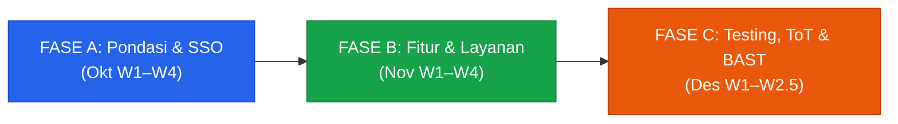
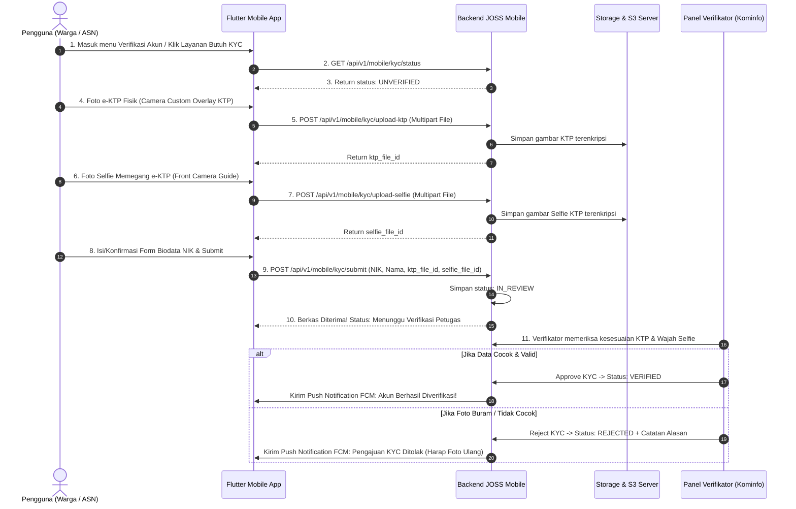

# Gantt Chart & Kanban Board Project — JOSS Mobile (Flutter)
## Proyek: Aplikasi JOSS Mobile (Android & iOS) — SSO Kabupaten Jombang (Fase 2)
### Target Penyelesaian: Pertengahan Desember 2026 (Cut-off Anggaran APBD 2026)

---

## I. Ringkasan Eksekutif & Struktur Proyek

| **Parameter** | **Keterangan** |
|---|---|
| **Nama Proyek** | JOSS Mobile (Jombang One Stop Service) — Fase 2 |
| **Klien** | Pemerintah Kabupaten Jombang — Dinas Komunikasi dan Informatika |
| **Teknologi** | Flutter (Dart), Keycloak OIDC+PKCE (`flutter_appauth`), Dio, SQLite/Hive, FCM |
| **Total Durasi** | **2,5 Bulan (11 Minggu Efektif)** |
| **Rentang Waktu** | **Minggu ke-1 Oktober 2026 s.d. Pertengahan Desember 2026** (14–18 Desember 2026) |
| **Hard Deadline** | **Pertengahan Desember 2026** *(Tutup buku APBD & penandatanganan BAST/SP2D)* |
| **Metodologi** | Hybrid Agile Scrum (Sprint 1–2 minggu) + Waterfall Milestone Compliance Pemerintah |



---

## II. Visual Gantt Chart (Mermaid Diagram)

```mermaid
gantt
    title Roadmap & Timeline Pelaksanaan JOSS Mobile (Fase 2)
    dateFormat  YYYY-MM-DD
    axisFormat  %d %b

    section FASE A: Pondasi, Desain & SSO
    Kick-off, KAK Final & Setup Repo Boilerplate       :done, a1, 2026-10-01, 2026-10-07
    Gap Analysis API & Identifikasi Modul Prioritas     :done, a2, 2026-10-03, 2026-10-09
    Desain UI/UX Figma (High-Fi) & Design System        :active, a3, 2026-10-08, 2026-10-15
    Approval Desain & Penyesuaian API Backend Baru     :active, a4, 2026-10-12, 2026-10-21
    Integrasi SSO Keycloak OIDC+PKCE (AppAuth)         :a5, 2026-10-16, 2026-10-24
    Manajemen Sesi, Secure Storage, Auto-login         :a6, 2026-10-22, 2026-10-31
    Milestone 1: Autentikasi SSO & Sesi Mobile Live    :milestone, m1, 2026-10-31, 0d

    section FASE B: Core Features & Layanan
    Sprint 1: Portal Layanan Utama & Bottom Nav        :b1, 2026-11-01, 2026-11-07
    Sprint 2: Profil Pengguna & Integrasi Layanan OPD  :b2, 2026-11-08, 2026-11-14
    Extra: ToT & Transfer Knowledge SSO ke Kominfo     :b3, 2026-11-10, 2026-11-15
    Sprint 3: Push Notifikasi (FCM) & Pengaturan Akun  :b4, 2026-11-15, 2026-11-21
    Persiapan Akun Google Play Console & Apple Dev     :b5, 2026-11-16, 2026-11-25
    Sprint 4: Offline Caching (SQLite/Hive) & Optimasi :b6, 2026-11-22, 2026-11-30
    Review Akhir Fase B & Persetujuan Klien            :b7, 2026-11-27, 2026-11-30
    Milestone 2: Seluruh Fitur Inti Selesai (Feature Complete) :milestone, m2, 2026-11-30, 0d

    section FASE C: Testing, UAT, ToT & BAST
    Alpha Testing Internal, Bug Fixing (Alpha Build)   :c1, 2026-12-01, 2026-12-07
    UAT Bersama Diskominfo Jombang                     :c2, 2026-12-08, 2026-12-11
    Penandatanganan Berita Acara UAT                   :c3, 2026-12-11, 2026-12-12
    ToT Admin/Pengelola & Master Build (RC)            :c4, 2026-12-10, 2026-12-13
    Submission Play Store & App Store                  :c5, 2026-12-12, 2026-12-16
    Serah Terima, Penandatanganan BAST & Handover      :c6, 2026-12-14, 2026-12-18
    Milestone 3: Final Review & Penutupan Proyek (BAST Sah) :milestone, m3, 2026-12-18, 0d
```

---

## III. Tabel Timeline Gantt Chart Mingguan (11 Minggu)

| **No** | **Minggu** | **Rentang Waktu** | **Fase / Modul Utama** | **Aktivitas & Deliverables** | **Target Output** |
|:---:|:---|:---|:---|:---|:---|
| **W1** | **Okt M1** | 01 – 07 Okt 2026 | **[Fase A]** Setup & Inisiasi | Kick-off rakor, finalisasi KAK, setup boilerplate Flutter, mapping API existing. | Dokumen KAK Final, Repo Boilerplate |
| **W2** | **Okt M2** | 08 – 14 Okt 2026 | **[Fase A]** UI/UX Design | Desain Figma High-Fidelity seluruh halaman, approval desain bersama MBO/klien. | Figma Link Final & Design System |
| **W3** | **Okt M3** | 15 – 21 Okt 2026 | **[Fase A]** SSO & Backend API | Integrasi Keycloak OIDC+PKCE via `flutter_appauth`, pembuatan API Backend mobile. | Login/Register SSO Mobile jalan |
| **W4** | **Okt M4** | 22 – 31 Okt 2026 | **[Fase A]** Keamanan Sesi | Secure Storage token handling, refresh token otomatis, auto-login, review Fase A. | Modul Keamanan Sesi Selesai |
| **W5** | **Nov M1** | 01 – 07 Nov 2026 | **[Fase B]** Sprint 1 | Portal Layanan Utama, Katalog Aplikasi, Navigasi Bottom Bar, Sprint Review 1. | Modul Portal Layanan Siap Demo |
| **W6** | **Nov M2** | 08 – 14 Nov 2026 | **[Fase B]** Sprint 2 | Profil pengguna, riwayat akses, integrasi layanan instansi OPD, Sprint Review 2. | Modul Profil & Layanan OPD |
| **--** | **Nov M2** | 10 – 14 Nov 2026 | **[Fase B]** Extra Training | **ToT & Pelatihan Teknis SSO Keycloak** khusus delegasi programmer Kominfo. | Berita Acara & Materi ToT SSO |
| **W7** | **Nov M3** | 15 – 21 Nov 2026 | **[Fase B]** Sprint 3 | Push Notification FCM, In-App Notification Center, Pengaturan Akun, setup Google Dev. | Modul Notifikasi FCM Berfungsi |
| **W8** | **Nov M4** | 22 – 30 Nov 2026 | **[Fase B]** Sprint 4 | Offline Caching (SQLite/Hive), connectivity checker, optimasi performa, QA Fase B. | Sign-off Fitur Fase B Lengkap |
| **W9** | **Des M1** | 01 – 07 Des 2026 | **[Fase C]** Alpha Testing | Internal Alpha testing, penyusunan test case (min. 50 skenario), bug fixing critical. | APK/IPA Alpha Build & Test Case |
| **W10**| **Des M2** | 08 – 12 Des 2026 | **[Fase C]** UAT & ToT Admin | **Pelaksanaan UAT bersama Diskominfo**, penandatanganan BA UAT, ToT Admin/Pengelola. | **Berita Acara (BA) UAT Sah**, Modul Panduan |
| **W11**| **Des M3** | 14 – 18 Des 2026 | **[Fase C]** Rilis, BAST & Tutup | **Submission Play Store & App Store**, serah terima source code, **Penandatanganan BAST**. | **BAST Sah, Project Closed** |

---

## IV. Kanban Board Project (Mapping ke Format Trello / Jira)

Board ini dirancang untuk dapat langsung dipetakan ke sistem manajemen tugas (seperti Trello/Jira Board Pemkab Jombang).

```
+-----------------------------------------------------------------------------------------------------------------------------------------+
|                                                      KANBAN BOARD: JOSS MOBILE (FASE 2)                                                 |
+-------------------+-------------------+-------------------+--------------------+------------------------+-------------------------------+
|  1. BACKLOG       |  2. TO DO         |  3. IN PROGRESS   |  4. INTERNAL QA    |  5. CLIENT REVIEW/UAT   |  6. DONE (BAST ACCEPTED)      |
|  (Scope & Icebox) |  (Current Sprint) |  (WIP Tim Dev)    |  (Testing Dev)     |  (Validasi Klien)      |  (Selesai & Disahkan)         |
+-------------------+-------------------+-------------------+--------------------+------------------------+-------------------------------+
```

### 1. Kolom: 📋 Backlog & Scope Kebutuhan (Icebox & Proposed)
Daftar modul pendukung yang menunggu konfirmasi scope lanjutan / Fase 3:
- [ ] `[NEWS-01]` **Portal Berita Jombang:** Feed RSS berita Pemkab *(Status: Tunggu API Kominfo)*
- [ ] `[NEWS-02]` **Detail Artikel Berita:** WebView baca artikel & share
- [ ] `[REPORT-01]` **Pengaduan Publik (E-Lapor):** Modul aduan warga + GPS & Foto
- [ ] `[UMKM-01]` **Katalog UMKM Daerah:** Direktori produk lokal Jombang
- [ ] `[TOUR-01]` **Pariwisata & Agenda:** Agenda wisata & budaya kota Jombang
- [ ] `[SET-02]` **Multi-Tema Lanjutan:** Custom palette tema OPD non-standard

### 2. Kolom: ⏳ To Do / Sprint Queue (Prioritas Siap Dikerjakan)
Item pekerjaan yang sudah di-breakdown dan siap ditarik ke pengerjaan:
- [ ] `[DEV-ACC]` Registrasi Akun Google Play Console & Apple Developer atas nama Pemkab Jombang *(Target W7)*
- [ ] `[BUILD-RC]` Persiapan signing keystore production & konfigurasi bundle release AAB/IPA *(Target W10)*
- [ ] `[DOC-BAST]` Draft Berita Acara Serah Terima (BAST) & Lampiran Serah Terima Aset *(Target W10)*

### 3. Kolom: ⚙️ In Progress (Sedang Dikerjakan / Active Work)
Aktivitas yang sedang berjalan pada sprint aktif saat ini:
- [ ] `[AUTH-01]` Desain UI/UX Figma High-Fidelity & Clickable Prototype (PIC: UI/UX Designer)
- [ ] `[API-MAP]` Sinkronisasi 10 Endpoint Backend Tambahan Mobile (PIC: Backend Dev)
- [ ] `[SYS-00]` Arsitektur Dasar Flutter BLoC/Riverpod + Modular Folder Structure (PIC: Lead Dev)

### 4. Kolom: 🧪 Code Review & Internal QA (Testing Developer)
Modul yang selesai dikoding dan masuk tahap pengujian internal:
- [ ] `[TEST-AUTH]` Unit Test modul autentikasi Keycloak OIDC (Authorization Code + PKCE)
- [ ] `[TEST-STORE]` Validasi keamanan enkripsi token di Keystore Android & iOS Keychain
- [ ] `[TEST-NET]` Simulasi interceptor refresh token saat token expired 401

### 5. Kolom: 🤝 Client Review & UAT (Validasi Pemkab Jombang)
Fitur yang didemokan dan diuji oleh perwakilan teknis / pejabat Diskominfo:
- [ ] `[REV-DESAIN]` Presentasi Desain UI/UX Figma ke Tim Kominfo Jombang *(Target W2)*
- [ ] `[REV-FASE-A]` Demo integrasi SSO Login/Register ke Tim Klien *(Target W4)*
- [ ] `[REV-FASE-B]` Sprint Demo fitur layanan utama & dashboard *(Target W8)*
- [ ] `[UAT-OFFICIAL]` **Pelaksanaan UAT Resmi (50 Test Cases) & Penandatanganan BA UAT** *(Target W10)*

### 6. Kolom: ✅ Done / Closed (Selesai & Sah Masuk Deliverables)
Item yang telah disetujui kedua belah pihak:
- [x] Dokumen KAK Final (Kerangka Acuan Kerja)
- [x] Client `joss-mobile` teregistrasi di Keycloak server `sso-v2.jombangkab.go.id`
- [x] Dokumen Gap Analysis API (Web vs Mobile)
- [x] Penyesuaian Jadwal Proyek ke batas akhir Pertengahan Desember 2026

---

## V. Rincian Scope of Work & Mapping Kebutuhan

> [!IMPORTANT]
> **Prinsip Utama:** Seluruh fitur yang saat ini sudah live di portal web **https://joss.jombangkab.go.id/** menjadi tanggung jawab **Tim Programmer Internal** untuk direplikasi penuh ke Flutter Mobile. Sementara itu, fitur layanan eksternal Pemkab (API Berita, API E-Lapor Aduan, Akun Developer Store) menjadi tanggung jawab **Tim Teknis / Mobile Dev Kominfo Jombang**.
> Detail lengkap pembagian task per personil dapat dilihat pada dokumen: [mapping_task_internal_vs_kominfo.md](file:///d:/sso_jos/mapping_task_internal_vs_kominfo.md).

### A. Mapping 25 Modul Inti Aplikasi JOSS Mobile (Tugas Programmer Internal)

| **Kategori** | **Kode Modul** | **Nama Modul** | **Deskripsi Scope & Fungsi (Mirroring Web JOSS)** | **Target Sprint / Minggu** |
|:---|:---|:---|:---|:---:|
| **Autentikasi** | `AUTH-01` | Splash & Onboarding | Splash screen identitas Pemkab Jombang, walk-through pengenalan JOSS Mobile. | W1–W2 (Okt) |
| | `AUTH-02` | Login SSO Keycloak | Login via Chrome Custom Tab / In-App Browser, OIDC + PKCE flow. | W3 (Okt) |
| | `AUTH-03` | Registrasi Akun SSO | Formulir pendaftaran akun terintegrasi langsung ke realm Keycloak `jombangkab`. | W3 (Okt) |
| | `AUTH-04` | Lupa & Reset Password | Request link reset password via email terdaftar via flow Keycloak. | W3 (Okt) |
| | `AUTH-05` | Manajemen Sesi & Token | Penyimpanan token di Secure Storage, auto-attach Bearer token pada Dio request. | W4 (Okt) |
| | `AUTH-06` | Refresh Token & Logout | Mekanisme refresh token otomatis, revocations token saat user logout. | W4 (Okt) |
| **Beranda & Nav** | `HOME-01` | Dashboard Utama | Tampilan profil ringkas, banner informasi dinamis, shortcut layanan populer. | W5 (Nov) |
| | `HOME-02` | Navigasi Bottom Bar | Navigasi 4 tab utama (Beranda, Layanan, Riwayat, Akun). | W5 (Nov) |
| **Katalog Layanan**| `SVC-01` | Katalog Layanan OPD | Daftar seluruh layanan SPBE/OPD Pemkab Jombang terkelompok per kategori. | W5 (Nov) |
| | `SVC-02` | Pencarian Layanan | Real-time search bar dengan fungsi debounce responsif. | W5 (Nov) |
| | `SVC-03` | Detail Informasi Layanan| Halaman informasi syarat, alur layanan, kontak pengelola, dan panduan. | W6 (Nov) |
| | `SVC-04` | Akses Layanan Eksternal| Integrasi Seamless Login (SSO) saat membuka link layanan via Chrome Custom Tab. | W6 (Nov) |
| **Profil & Akun** | `USR-01` | Profil Warga / ASN | Tampilan data NIK, Nama, Email, Nomor Telepon, Instansi, dan status verifikasi. | W6 (Nov) |
| | `USR-02` | Edit Profil & Foto | Pembaharuan data kontak dan upload foto profil langsung dari kamera/galeri. | W6 (Nov) |
| | `USR-03` | Ubah Password | Fitur ganti password dari dalam aplikasi (sinkronisasi ke Keycloak). | W7 (Nov) |
| | `USR-04` | Status Verifikasi KYC | Indikator verifikasi akun (Warga Terverifikasi / Belum Terverifikasi). | W6 (Nov) |
| **Notifikasi** | `NOTIF-01` | Push Notification FCM | Integrasi Firebase Cloud Messaging untuk notifikasi pengumuman & blast dinas. | W7 (Nov) |
| | `NOTIF-02` | Notification Center | Halaman arsip pesan notifikasi masuk, tanda baca, dan filter notifikasi. | W7 (Nov) |
| **Riwayat** | `HIST-01` | Riwayat Akses / Aktivitas| Log jejak aktivitas login dan riwayat layanan yang pernah dibuka pengguna. | W6 (Nov) |
| **Pengaturan** | `SET-01` | Pengaturan & Preferensi| Konfigurasi notifikasi, bahasa, preferensi tampilan, dan syarat ketentuan. | W7 (Nov) |
| **Sistem & Core** | `SYS-01` | Offline Caching | Penyimpanan offline data katalog layanan & profil via local DB (SQLite/Hive). | W8 (Nov) |
| | `SYS-02` | Connectivity Checker | Deteksi koneksi internet dengan visual banner offline/online mode. | W8 (Nov) |
| | `SYS-03` | Force Update Check | Pengecekan versi minimum aplikasi ke server backend untuk menjaga kompatibilitas. | W8 (Nov) |
| | `SYS-04` | Deep Linking Handler | Penanganan link dinamis (notifikasi promo / verifikasi email). | W8 (Nov) |
| | `SYS-05` | Crashlytics & Error Log | Pelaporan crash otomatis menggunakan Firebase Crashlytics. | W9 (Des) |

---

### B. Mapping Endpoint API Backend Khusus Mobile & Sub-Sistem Verifikasi e-KYC

API berikut merupakan kebutuhan fungsional di sisi server yang disiapkan oleh tim Backend pada sprint Fase A (Okt W2–W3) agar dapat dikonsumsi penuh oleh aplikasi Flutter Mobile:

#### 1. Daftar Endpoint API Backend Mobile (Core & e-KYC)

| **No** | **Kategori** | **Endpoint Mobile** | **Method** | **Fungsi & Deskripsi Teknis** | **Payload / Request Data** |
|:---:|:---|:---|:---:|:---|:---|
| 1 | **Profil** | `/api/v1/mobile/profile` | `GET`, `PUT` | Ambil data profil (NIK, Nama, Email, No HP, Alamat, Status KYC) & update kontak | `email`, `phone_number` *(Bearer Token)* |
| 2 | **Profil** | `/api/v1/mobile/profile/photo` | `POST` | Upload & ubah foto profil pengguna | Multipart `photo` (JPG/PNG, max 2MB) |
| 3 | **e-KYC** | `/api/v1/mobile/kyc/status` | `GET` | Cek status verifikasi akun (`UNVERIFIED`, `IN_REVIEW`, `VERIFIED`, `REJECTED`) + catatan penolakan | *(Bearer Token)* |
| 4 | **e-KYC** | `/api/v1/mobile/kyc/upload-ktp` | `POST` | **Upload foto fisik e-KTP**: Validasi format gambar, kompresi server, deteksi kejelasan KTP | Multipart `ktp_image` (JPG/PNG, max 5MB) → Response: `ktp_file_id` & temp URL |
| 5 | **e-KYC** | `/api/v1/mobile/kyc/upload-selfie` | `POST` | **Upload foto selfie memegang e-KTP**: Validasi wajah dan fisik KTP dalam 1 frame foto | Multipart `selfie_ktp_image` (JPG/PNG, max 5MB) → Response: `selfie_file_id` |
| 6 | **e-KYC** | `/api/v1/mobile/kyc/submit` | `POST` | **Submit Berkas e-KYC Final**: Mengirim data identitas lengkap beserta ID file KTP & Selfie untuk diverifikasi admin Disdukcapil/Kominfo | JSON: `nik`, `nama_lengkap`, `tempat_lahir`, `tanggal_lahir`, `alamat`, `ktp_file_id`, `selfie_file_id` |
| 7 | **Layanan** | `/api/v1/mobile/layanan` | `GET` | Ambil daftar layanan OPD (dukungan filter `category_id`, search query, pagination, sort) | Query params: `category_id`, `search`, `page`, `limit` |
| 8 | **Layanan** | `/api/v1/mobile/layanan/{id}` | `GET` | Detail lengkap layanan: deskripsi, syarat dokumen, kontak OPD, flag `is_kyc_required`, URL akses SSO | Path param: `id` |
| 9 | **Layanan** | `/api/v1/mobile/kategori` | `GET` | Master kategori layanan (`Populer`, `Kepegawaian`, `Ketenagakerjaan`, `Layanan Publik`) + hex color & icon name | *(Public / Bearer)* |
| 10 | **Banner** | `/api/v1/mobile/banners` | `GET` | Daftar gambar slider hero beranda aktif dari `manajemen-joss.jombangkab.go.id` | *(Public / Bearer)* |
| 11 | **Riwayat** | `/api/v1/mobile/riwayat` | `GET` | Log jejak riwayat aktivitas login dan akses layanan yang pernah dibuka warga | Query params: `page`, `limit` |
| 12 | **Notifikasi** | `/api/v1/mobile/notifikasi` | `GET` | List notifikasi inbox user (pengumuman dinas, update status KYC, peringatan sistem) | Query params: `page`, `status` (`read`/`unread`) |
| 13 | **Notifikasi** | `/api/v1/mobile/notifikasi/{id}/read`| `PUT` | Tandai notifikasi spesifik telah dibaca | Path param: `id` |
| 14 | **Notifikasi** | `/api/v1/mobile/notifikasi/register` | `POST` | Registrasi token perangkat FCM (Firebase) ke user ID untuk push notification | JSON: `fcm_token`, `device_type` (`android`/`ios`), `device_model` |
| 15 | **Sistem** | `/api/v1/mobile/app-version` | `GET` | Validasi versi aplikasi client: memicu force update jika rilis versi lama di bawah minimal | Query params: `platform` (`android`/`ios`), `current_version` |

---

#### 2. Alur Teknis Sub-Sistem Verifikasi e-KYC di Mobile & Backend



---

---

### C. Alih Pengetahuan & Pelatihan Teknis (ToT Scope)

Untuk menjamin keberlanjutan pasca-proyek dan menindaklanjuti kesenjangan teknis di Fase 1, diadakan dua agenda pelatihan:

1. **Pelatihan Teknis SSO Keycloak (Khusus Programmer Kominfo Jombang)**
   - **Waktu:** Minggu ke-2 November 2026 (W6)
   - **Materi:** Arsitektur Keycloak, Realm configuration, Client setup, Troubleshooting token JWT, Log session, dan integrasi API.
   - **Target:** Tim internal Kominfo mampu mengelola server Keycloak secara independen tanpa ketergantungan vendor.

2. **Training of Trainer (ToT) Operasional Aplikasi Mobile**
   - **Waktu:** Minggu ke-2 Desember 2026 (W10 — Pasca UAT)
   - **Materi:** Instalasi aplikasi, pengelolaan katalog layanan, panduan login warga/ASN, handling tiket bantuan error, dan monitoring crash.
   - **Target:** Admin OPD dan helpdesk siap memberikan panduan kepada masyarakat/ASN.

---

## VI. Matriks Peran & Tanggung Jawab (RACI Matrix)

* **R (Responsible):** Pelaksana tugas utama  
* **A (Accountable):** Penanggung jawab & pengambil keputusan final  
* **C (Consulted):** Pihak yang diajak koordinasi / konsultasi  
* **I (Informed):** Pihak yang diberi laporan hasil  

| **Aktivitas Pekerjaan** | **Project Manager** | **Lead Dev & Mobile** | **Backend Dev** | **Kominfo Jombang** | **Top Management MBO** |
|:---|:---:|:---:|:---:|:---:|:---:|
| Finalisasi KAK & Scope Modul | **A** | C | C | **R** | **A** |
| Approval Desain UI/UX Figma | C | C | I | **R** | **A** |
| Pengembangan API Backend Tambahan | I | C | **R** | C | I |
| Implementasi Coding Flutter (SSO & Core) | A | **R** | C | I | I |
| Pelatihan Teknis Keycloak (Nov W6) | A | **R** | R | **R** | I |
| Pengujian UAT (Test Case Execution) | A | R | C | **R / A** | I |
| Persetujuan Berita Acara (BA) UAT | **R** | I | I | **A** | C |
| Submission Play Store & App Store | A | **R** | I | C | I |
| **Penandatanganan BAST & Serah Terima** | **R** | I | I | **A** | **A** |

---

## VII. Checklist Persiapan Serah Terima & BAST (Pertengahan Desember 2026)

Daftar dokumen dan aset yang wajib dipenuhi sebelum penandatanganan BAST:

- [ ] **Aset Aplikasi:**
  - [ ] Source Code lengkap proyek Flutter di Repository GitHub/GitLab Kominfo Jombang.
  - [ ] Master APK / AAB (Android App Bundle) Release Production bertandatangan Keystore resmi.
  - [ ] Master IPA (iOS App Store Archive) atau konfigurasi bundle iOS siap rilis.
- [ ] **Dokumentasi Teknis:**
  - [ ] Dokumen Kerangka Acuan Kerja (KAK) Final bertandatangan.
  - [ ] Dokumen Desain Sistem & Panduan Desain (Figma Link).
  - [ ] Dokumen API Specification (Swagger/Postman Collection).
  - [ ] Dokumen Panduan Deployment & Panduan Penggunaan Aplikasi (Buku Manual User).
- [ ] **Kelengkapan Administrasi Pertanggungjawaban:**
  - [ ] Berita Acara UAT (User Acceptance Testing) bertandatangan lengkap dengan lampiran test sheet.
  - [ ] Laporan Pelaksanaan Training of Trainer (ToT) lengkap dengan daftar hadir dan foto kegiatan.
  - [ ] Berita Acara Serah Terima Hasil Pekerjaan (BAST) untuk pemenuhan pencairan anggaran SP2D Tahun Anggaran 2026.

---
*Dokumen ini disusun sebagai instrumen monitoring proyek JOSS Mobile (Fase 2) Pemkab Jombang.*  
*Status: Aktif & Terkalibrasi dengan Deadline Pertengahan Desember 2026.*
