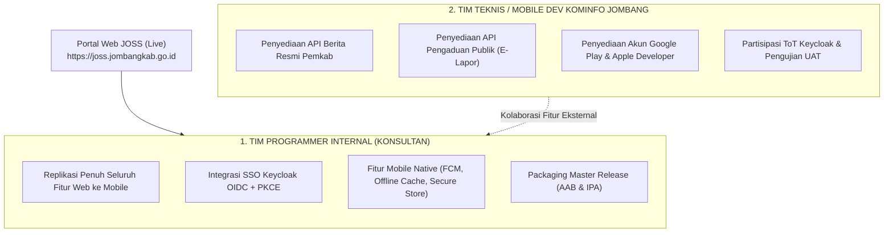
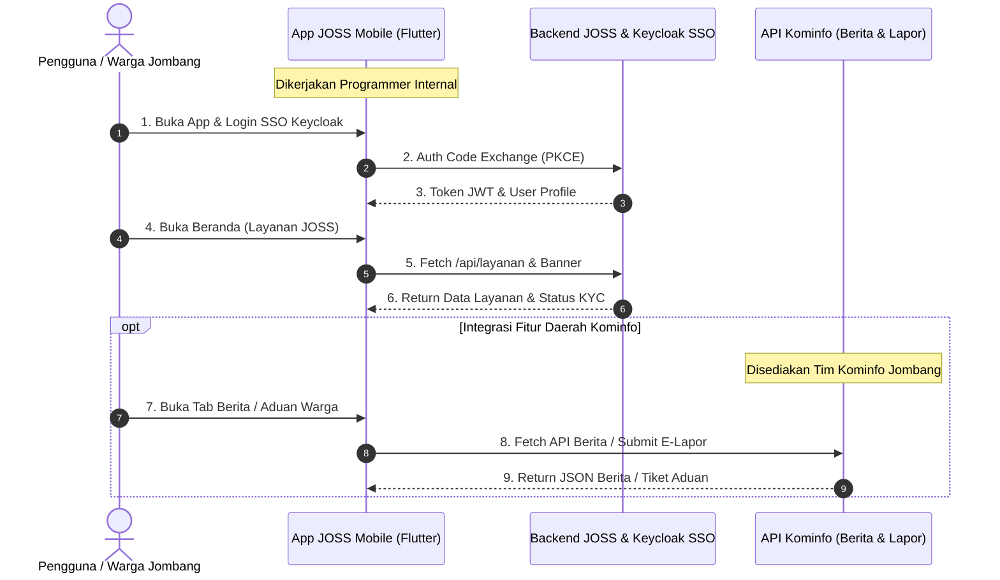

# Mapping Pembagian Task Proyek JOSS Mobile (Flutter)
## Proyek: JOSS Mobile — SSO Kabupaten Jombang (Fase 2)
### Acuan Utama: Portal Web Live [https://joss.jombangkab.go.id/](https://joss.jombangkab.go.id/)

---

## I. Prinsip Dasar Pembagian Kerja

Proyek ini membagi lingkup tugas secara tegas menjadi 2 entitas pelaksana:

1. **Tim Programmer Internal (Konsultan):**
   - **Prinsip:** *Semua fitur, alur, dan fungsi yang saat ini sudah berjalan di portal web JOSS (`joss.jombangkab.go.id`) WAJIB tersedia dan berfungsi optimal di aplikasi Flutter Mobile.*
   - Bertanggung jawab atas stabilitas arsitektur, keamanan sesi, caching offline, dan rilis build aplikasi ke store.

2. **Tim Mobile Dev / Teknis Kominfo Jombang:**
   - **Prinsip:** Bertanggung jawab atas penyediaan akses dan API sistem eksternal milik Pemkab Jombang (Berita, Pengaduan Daerah, UMKM) serta kelengkapan legalitas/akun developer instansi.

---

## II. Task Board: Programmer Internal (Replikasi Web JOSS ke Mobile)

Semua task di bawah ini merujuk langsung pada implementasi yang sudah ada di portal web `https://joss.jombangkab.go.id/`:

### A. Modul Header, Beranda, & Navigasi
| ID Task | Nama Task | Referensi Fitur di Web JOSS | Target Output Mobile |
|:---|:---|:---|:---|
| `INT-NAV-01` | **Struktur Navigasi Utama** | Navbar atas & sidebar mobile menu (`#mobile-sidebar`) | Bottom Navigation Bar (4 Tab: Beranda, Layanan, Riwayat, Akun) + Drawer cadangan |
| `INT-NAV-02` | **Hero Slider Banner Dinamis** | Swiper/Banner slider `#hero-slider` dari `manajemen-joss.jombangkab.go.id` | Image Carousel Slider otomatis dengan auto-scroll, indikator titik, dan caching gambar |
| `INT-NAV-03` | **Quick Call-to-Action (CTA)** | Tombol "Mulai Gunakan JOSS" & "Panduan" | Floating / Primary action card di halaman Beranda untuk shortcut layanan & panduan |

### B. Modul Katalog Layanan, Kategori, & Pencarian
| ID Task | Nama Task | Referensi Fitur di Web JOSS | Target Output Mobile |
|:---|:---|:---|:---|
| `INT-SVC-01` | **Filter Kategori Layanan** | Sidebar kategori (`Populer`, `Kepegawaian (id:3)`, `Ketenagakerjaan (id:4)`, `Layanan Publik (id:7)`) | Horizontal category chips dengan icon, warna kategori, dan state aktif dinamis |
| `INT-SVC-02` | **Pencarian Real-Time (Search)** | Input search `#search-service` dengan fungsi debounce 300ms | Search bar AppBar dengan debounce, clear button, dan pencarian instan lokal + API |
| `INT-SVC-03` | **Grid & Card Layanan Publik** | Grid kartu layanan `#popular-services-grid` (menampilkan icon, nama layanan, instansi, & tombol akses) | Responsive GridView (2 kolom di mobile) dengan card elevation, loading shimmer/skeleton |
| `INT-SVC-04` | **Integrasi API `/api/layanan`** | Endpoint AJAX `https://joss.jombangkab.go.id/api/layanan?category_id=...&search=...` | Service layer Dio untuk fetch JSON layanan, parsing model Dart, dan error retry handler |
| `INT-SVC-05` | **Akses Layanan OPD Seamless** | Tombol klik layanan pihak ketiga (`.js-aplikasi-akses-link`) | Buka webapp layanan OPD menggunakan **Chrome Custom Tabs (Android)** & **Safari Services (iOS)** tanpa login ulang (SSO pass-through) |

### C. Modul Validasi & Pengajuan e-KYC (Know Your Customer)

Modul ini menangani verifikasi identitas resmi warga Kabupaten Jombang agar memenuhi standar keamanan akses layanan kependudukan dan perizinan:

| ID Task | Nama Task | Referensi Fitur di Web JOSS | Target Output Mobile & Alur Teknis |
|:---|:---|:---|:---|
| `INT-KYC-01` | **Pengecekan Status KYC Akun** | Objek JavaScript `window.KycConfig.isVerified` | State checker akun user: `UNVERIFIED`, `IN_REVIEW`, `VERIFIED`, `REJECTED` |
| `INT-KYC-02` | **Modal Alert Akun Belum Terverifikasi** | Popup modal `#kyc-alert-modal` ("Dokumen pendaftaran Saudara sedang dalam antrean proses verifikasi...") | Dialog / BottomSheet native Flutter yang memblokir akses layanan tertentu dan mengarahkan warga ke form KYC |
| `INT-KYC-03` | **Formulir Pengajuan Identitas e-KYC** | Form pendaftaran identitas terverifikasi | Form input NIK (16 digit validator), Nama Lengkap (sesuai e-KTP), Tempat/Tgl Lahir, dan Alamat Domisili |
| `INT-KYC-04` | **Kamera Capture Foto e-KTP Fisik** | Upload KTP di registrasi | Custom camera screen dengan **Overlay Bingkai KTP**, panduan pencahayaan, auto-rotate, kompresi gambar client-side (maks 1MB) |
| `INT-KYC-05` | **Kamera Selfie Memegang e-KTP** | Verifikasi kepemilikan fisik KTP | Custom front-camera dengan **Panduan Garis Wajah & Posisi KTP di Dada**, petunjuk foto tidak boleh blur/tertutup jari |
| `INT-KYC-06` | **Layar Preview & Konfirmasi Berkas** | Ringkasan pendaftaran dokumen | Halaman review foto KTP & foto selfie sebelum dikirim, tombol "Ulangi Foto" atau "Kirim Berkas" |
| `INT-KYC-07` | **Halaman Tracking Status Pengajuan** | Notifikasi / status antrean verifikasi | Tampilan timeline tahapan: *1. Berkas Diterima → 2. Verifikasi Petugas → 3. Akun Aktif / Ditolak (lengkap catatan revisi & tombol foto ulang)* |

#### Task Backend Terkait e-KYC (Tim Internal Backend):
- `INT-BE-01`: `POST /api/v1/mobile/kyc/upload-ktp` — Handle upload multipart file KTP, validasi mime-type, simpan ke storage secure.
- `INT-BE-02`: `POST /api/v1/mobile/kyc/upload-selfie` — Handle upload multipart selfie pegang KTP, enkripsi file di server.
- `INT-BE-03`: `POST /api/v1/mobile/kyc/submit` — Simpan record pengajuan verifikasi identitas warga ke database & set status `IN_REVIEW`.
- `INT-BE-04`: `GET /api/v1/mobile/kyc/status` — Ambil status KYC terkini beserta alasan penolakan (jika ada).
- `INT-BE-05`: Trigger Push Notification FCM otomatis saat admin verifikator menyetujui / menolak pengajuan KYC warga.

### D. Modul Autentikasi SSO Keycloak
| ID Task | Nama Task | Referensi Fitur di Web JOSS | Target Output Mobile |
|:---|:---|:---|:---|
| `INT-AUTH-01` | **Login SSO OIDC + PKCE** | Alur login `https://joss.jombangkab.go.id/auth/login` → Keycloak | In-App Browser via library `flutter_appauth` ke Realm `jombangkab`, menangkap Auth Code & Access Token |
| `INT-AUTH-02` | **Registrasi Akun Baru** | Alur daftar `https://joss.jombangkab.go.id/register` | Redirect WebView ke formulir registrasi Keycloak realm Jombang |
| `INT-AUTH-03` | **Lupa / Reset Password** | Alur forgot-password Keycloak | Redirect browser ke flow recovery Keycloak Jombang |
| `INT-AUTH-04` | **Konfirmasi Logout** | Modal konfirmasi logout `#logout-modal` & POST form `/auth/logout` | Native bottom sheet konfirmasi logout, hapus token di HP, dan panggil endpoint revoke Keycloak |
| `INT-AUTH-05` | **Manajemen Sesi & Auto-Login** | Persistent session cookie web | Flutter Secure Storage (Android Keystore / iOS Keychain), auto-refresh token saat HTTP 401 |

### E. Fitur Tambahan Khusus Mobile (Mobile Native)
| ID Task | Nama Task | Deskripsi Teknis |
|:---|:---|:---|
| `INT-MOB-01` | **Push Notification (FCM)** | Integrasi Firebase Cloud Messaging untuk notifikasi pengumuman dinas & status akun |
| `INT-MOB-02` | **In-App Notification Center** | Halaman daftar notifikasi yang pernah diterima pengguna |
| `INT-MOB-03` | **Offline Mode (Local Database)** | Caching katalog layanan dan data profil menggunakan SQLite / Hive agar tetap bisa dibuka tanpa internet |
| `INT-MOB-04` | **Connectivity Detector** | SnackBar banner otomatis jika koneksi internet terputus / terhubung kembali |
| `INT-MOB-05` | **Build & Release Store Packaging** | Setup App Icon, Splash Screen native, ProGuard/R8, Keystore signing, build AAB & IPA |

---

## III. Task Board: Tim Teknis / Mobile Dev Kominfo Jombang

Task berikut merupakan area kolaborasi dan tanggung jawab pihak **Dinas Kominfo Jombang**:

### A. Penyediaan API Fitur Daerah (Fitur Non-Web JOSS)
| ID Task | Nama Task | Uraian Kebutuhan & Spesifikasi API | PIC Kominfo |
|:---|:---|:---|:---|
| `KMF-API-01` | **API Feed Berita Resmi Jombang** | Sediakan endpoint JSON berita dari portal resmi Pemkab (`https://jombangkab.go.id`): • `GET /api/v1/berita` (judul, thumbnail, tanggal, kategori, konten ringkas, URL lengkap) | Backend Kominfo |
| `KMF-API-02` | **API Pengaduan Publik (E-Lapor)** | Sediakan endpoint integrasi sistem aduan warga Jombang: • `POST /api/v1/pengaduan` (judul, deskripsi, upload foto, latitude, longitude) • `GET /api/v1/pengaduan/riwayat` (status tracking aduan: *Diterima, Diproses, Selesai*) | Tim Programmer Kominfo |
| `KMF-API-03` | **API Direktori UMKM / Wisata (Opsional)** | Sediakan endpoint data produk UMKM dan destinasi wisata jika disepakati masuk scope tambahan | Seksi Aplikasi Kominfo |

### B. Akun Developer & Kepatuhan Legalitas Store
| ID Task | Nama Task | Uraian Kebutuhan | Batas Waktu |
|:---|:---|:---|:---|
| `KMF-ACC-01` | **Akun Google Play Console Instansi** | Siapkan akun Google Play Developer terverifikasi atas nama Pemerintah Kabupaten Jombang (organisasi D-U-N-S registered) | Minggu ke-3 Nov 2026 |
| `KMF-ACC-02` | **Akun Apple Developer Program** | Siapkan akun Apple Developer Organization Pemkab Jombang untuk rilis iOS | Minggu ke-3 Nov 2026 |
| `KMF-ACC-03` | **Kebijakan Privasi (Privacy Policy URL)** | Siapkan link resmi Privacy Policy di domain `jombangkab.go.id` sebagai syarat kepatuhan Play Store & App Store | Minggu ke-3 Nov 2026 |

### C. Alih Pengetahuan & Validasi Proyek
| ID Task | Nama Task | Uraian Kegiatan | Waktu Pelaksanaan |
|:---|:---|:---|:---|
| `KMF-TOT-01` | **Partisipasi ToT Teknis Keycloak** | Mengirimkan 2–3 programmer Kominfo untuk mengikuti pelatihan arsitektur & administrasi Keycloak SSO | Minggu ke-2 Nov 2026 |
| `KMF-UAT-01` | **Pengujian & Evaluasi UAT** | Menguji 50 skenario test case di perangkat Android & iOS bersama tim konsultan | Minggu ke-2 Des 2026 |
| `KMF-BAST-01` | **Penandatanganan Berita Acara (BA UAT & BAST)** | Memverifikasi kelengkapan deliverables dan memproses BAST untuk pencairan SP2D anggaran 2026 | Minggu ke-2 s.d. 3 Des 2026 |

---

## IV. Diagram Interaksi & Alur Kerja Antar Tim

---

## V. Matriks Checklist Kesiapan (Ready for Sprint)

| Komponen Fitur | Penanggung Jawab | Kesiapan Backend / API | Status Pengerjaan Mobile |
|---|:---:|:---:|:---:|
| **SSO Login / Register** | Internal Dev | ✅ API Keycloak Live | 🚀 Siap Eksekusi (Okt W3) |
| **Katalog Layanan & Kategori** | Internal Dev | ✅ Endpoint `/api/layanan` Live | 🚀 Siap Eksekusi (Nov W1) |
| **Pencarian Layanan (Search)** | Internal Dev | ✅ Filter Search API Live | 🚀 Siap Eksekusi (Nov W1) |
| **Banner Hero Slider** | Internal Dev | ✅ Media Storage Live | 🚀 Siap Eksekusi (Nov W1) |
| **Pengecekan KYC Modal** | Internal Dev | ✅ Logika KYC Live di Web | 🚀 Siap Eksekusi (Nov W2) |
| **Seamless CCT Layanan OPD** | Internal Dev | ✅ SSO Redirect Web Live | 🚀 Siap Eksekusi (Nov W2) |
| **Push Notification FCM** | Internal Dev | ⚙️ Setup Firebase Admin | ⏳ Dijadwalkan (Nov W3) |
| **Offline Cache & Local DB** | Internal Dev | ✅ Menggunakan Cache Lokal HP | ⏳ Dijadwalkan (Nov W4) |
| **Feed Berita Jombang** | Kominfo Jombang | ⏳ Menunggu Endpoint Kominfo | 📋 Menunggu Endpoint Siap |
| **Aduan Publik (E-Lapor)** | Kominfo Jombang | ⏳ Menunggu Endpoint Kominfo | 📋 Menunggu Endpoint Siap |
| **Akun Google & Apple Store** | Kominfo Jombang | ⏳ Proses Verifikasi Instansi | 📋 Ditargetkan Nov W3 |

---
*Dokumen ini merupakan panduan operasional pembagian task antara Tim Programmer Internal dan Tim Kominfo Jombang agar sinkronisasi fitur web ke mobile berjalan presisi.*
